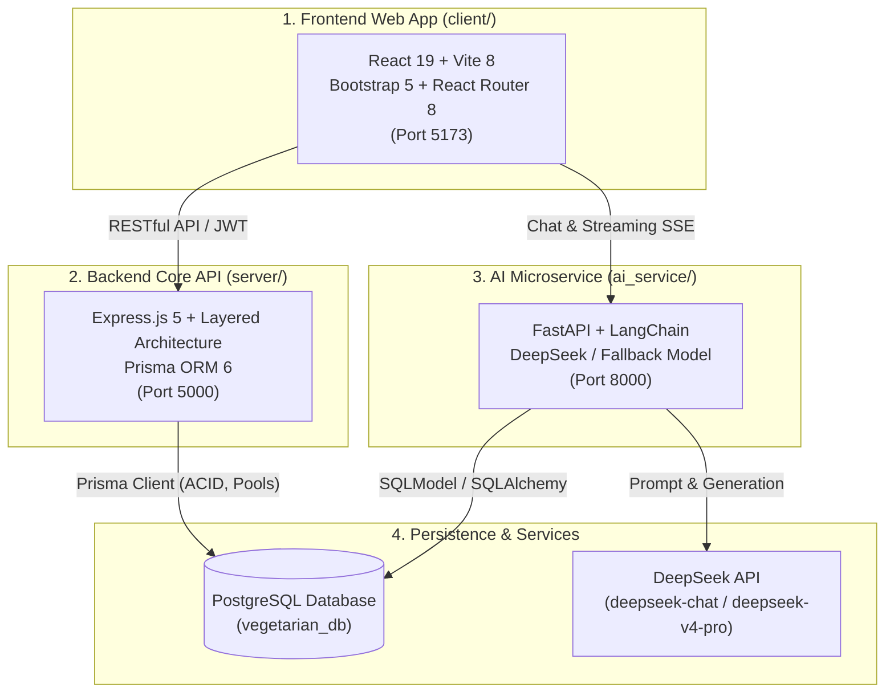

[](https://github.com/minHow14/SWP391/actions/workflows/ci.yml)

# 🌱 Chay Xanh - Nền Tảng Hỗ Trợ Ăn Chay & Sống Khỏe Toàn Diện

> **Dự án SWP391 - FPT University | Software Development Project**  
> Hệ thống tích hợp toàn diện gồm ứng dụng Web SPA, Backend REST API phân tầng, và AI Microservice tư vấn dinh dưỡng thông minh.

---

## 📖 Giới thiệu dự án

**Chay Xanh** ra đời nhằm hỗ trợ cộng đồng tiếp cận lối sống ăn chay khoa học, lành mạnh và bền vững. Nền tảng kết hợp giữa mạng xã hội ẩm thực, công cụ khám phá món chay, tìm kiếm địa điểm quán ăn chay lân cận và trợ lý ảo AI hỗ trợ lập thực đơn cá nhân hóa.

### Các vấn đề hệ thống giải quyết:
1. **Thiếu kiến thức dinh dưỡng cân bằng:** Giải quyết nỗi lo thiếu vi chất (B12, sắt, canxi, protein thực vật) khi chuyển sang chế độ ăn chay.
2. **Khó khăn trong việc lên thực đơn:** Trợ lý AI tự động tính toán nhu cầu calo và đề xuất thực đơn 7 ngày phù hợp với thể trạng, mục tiêu sức khỏe và dị ứng thực phẩm.
3. **Tìm kiếm địa điểm ăn chay:** Tìm kiếm nhà hàng, quán chay uy tín xung quanh người dùng dựa trên định vị địa lý (GPS).
4. **Kết nối cộng đồng:** Chia sẻ công thức, nhật ký nấu nướng, video hướng dẫn và thảo luận cùng cộng đồng người ăn chay.

---

## 🏛️ Kiến trúc tổng thể hệ thống

Hệ thống được tổ chức theo cấu trúc đa dịch vụ (Multi-service Monorepo):



---

## 📂 Cấu trúc dự án (Monorepo Structure)

```text
SWP391/
├── client/                    # [Frontend] Ứng dụng Web SPA React 19 + Vite
│   ├── src/                   # Components, Pages (Home, Recipes, Community, Login), Libs
│   ├── test/                  # Kiểm thử logic bộ lọc món ăn & lựa chọn chế độ ăn
│   └── README.md              # Tài liệu chi tiết cho phân hệ Frontend
│
├── server/                    # [Backend] REST API Express.js + Prisma ORM + PostgreSQL
│   ├── src/                   # Controllers, Services, Routes, Middlewares, Validators
│   ├── prisma/                # Schema Prisma định nghĩa 23 models cơ sở dữ liệu
│   ├── test/ & tests/         # 21 bài kiểm thử tự động với Vitest
│   └── README.md              # Tài liệu chi tiết cho phân hệ Backend Server
│
├── ai_service/                # [AI Agent] Trợ lý ảo tư vấn dinh dưỡng & Lập thực đơn
│   ├── agents/                # Chatbot Agent (Cache) & Meal Planner Agent
│   ├── api/                   # APIRouter: /api/chat, /api/meal-planner, /api/admin
│   ├── core/                  # LLM setup, Fallback model, Rate limiting, Quota
│   ├── prompts/               # System prompts định hình chuyên gia dinh dưỡng
│   ├── tests/                 # Kiểm thử tự động với Pytest
│   └── README.md              # Tài liệu chi tiết cho phân hệ AI Service
│
└── README.md                  # Tài liệu tổng quan toàn bộ dự án
```

---

## 🛠️ Công nghệ sử dụng (Tech Stack)

| Thành phần | Công nghệ chính | Thư viện & Công cụ bổ trợ |
| :--- | :--- | :--- |
| **Frontend** | React 19, Vite 8, React Router 8 | Bootstrap 5, Bootstrap Icons, Node Test Runner |
| **Backend Server** | Node.js (ESM), Express.js 5 | Prisma ORM 6, PostgreSQL, Zod, bcryptjs, jsonwebtoken, Vitest, Supertest, express-rate-limit, Geolib, Fuse.js |
| **AI Microservice** | Python 3.11+, FastAPI, Uvicorn | LangChain, DeepSeek API (v4 Fallback), SQLModel, SQLAlchemy, SlowAPI, sse-starlette, Pydantic v2, Pytest |
| **Database** | PostgreSQL >= 15 | Prisma Migrations/Push, connection pooling |

---

## ⚡ Hướng dẫn cài đặt & Khởi chạy nhanh

### Yêu cầu tiên quyết (Prerequisites)
- [Node.js](https://nodejs.org/) `>= 20.x` & `npm >= 10.x`
- [Python](https://www.python.org/) `>= 3.11.x`
- [PostgreSQL](https://www.postgresql.org/) `>= 15.x`

---

### Bước 1: Chuẩn bị Cơ sở dữ liệu PostgreSQL
Tạo cơ sở dữ liệu có tên `vegetarian_db` trong PostgreSQL:
```sql
CREATE DATABASE vegetarian_db;
```

---

### Bước 2: Khởi chạy Backend Server (Port 5000)

```bash
# 1. Chuyển vào thư mục server
cd server

# 2. Cài đặt dependencies
npm install

# 3. Tạo file cấu hình môi trường
cp .env.example .env
# Chỉnh sửa .env: điền DATABASE_URL và JWT_SECRET

# 4. Sinh Prisma Client và đồng bộ schema vào database
npm run prisma:generate
npm run prisma:push

# 5. Nạp toàn bộ dữ liệu mẫu & xác thực tự động vào cơ sở dữ liệu
npm run seed            # Nạp 56 câu lệnh dữ liệu chuẩn từ seed.sql & tự động xác thực

# 6. Khởi chạy server ở chế độ phát triển
npm run dev
```
> Server sẽ chạy tại: `http://localhost:5000` (Kiểm tra tại `http://localhost:5000/health`)

#### 🔑 Tài khoản mẫu đăng nhập kiểm thử:
- **Quản trị viên (Admin):** `admin@swp391.com` | Mật khẩu: `123456`
- **Người dùng mẫu (User):** `user@swp391.com` | Mật khẩu: `123456`
- **Người dùng mẫu khác:** `lan.nguyen@swp391.com` | Mật khẩu: `123456`

---

### Bước 3: Khởi chạy AI Microservice (Port 8000)

```bash
# 1. Mở terminal mới và chuyển vào thư mục ai_service
cd ai_service

# 2. Tạo và kích hoạt môi trường ảo
python -m venv venv
.\venv\Scripts\Activate.ps1    # Trên Windows
# source venv/bin/activate     # Trên Linux / macOS

# 3. Cài đặt thư viện Python
pip install -r requirements.txt

# 4. Tạo file cấu hình môi trường .env (tham khảo ai_service/README.md)
# Điền DEEPSEEK_API_KEY và kết nối database

# 5. Chạy AI service
python -m uvicorn main:app --host 0.0.0.0 --port 8000 --reload
```
> AI Service sẽ chạy tại: `http://localhost:8000` (Tài liệu tương tác: `http://localhost:8000/docs`)

---

### Bước 4: Khởi chạy Frontend Web App (Port 5173)

```bash
# 1. Mở terminal mới và chuyển vào thư mục client
cd client

# 2. Cài đặt dependencies
npm install

# 3. Chạy client ở chế độ phát triển
npm run dev
```
> Mở trình duyệt và truy cập: `http://localhost:5173`

---

## 🧪 Kiểm thử tự động (Automated Testing)

Hệ thống được thiết kế với tiêu chuẩn kiểm thử nghiêm ngặt tại tất cả các phân hệ:

| Phân hệ | Lệnh kiểm thử | Công cụ | Nội dung kiểm thử |
| :--- | :--- | :--- | :--- |
| **Frontend** | `npm test` (trong `client/`) | Node.js Test Runner | Kiểm thử 30 ca: phiên đăng nhập bộ nhớ, mã hóa chế độ ăn, scanner, nhật ký calo theo ngày/tuần, upload media, bộ lọc công thức không dấu |
| **Backend** | `npm test` (trong `server/`) | Vitest + Supertest | Kiểm thử 21 ca: API Boundary, validate Zod schema, Places API, Rate limit |
| **Database** | `npm run test:database` | Node.js Integration | Kiểm thử catalog, auth, cộng đồng CRUD/comments/votes, nhật ký, dinh dưỡng, kế hoạch tuần, đánh giá quán |
| **Seed & Verify DB** | `npm run seed` | Seed SQL Runner | Nạp 56 câu lệnh, 30 bảng, 42 bữa ăn tuần và tự động xác thực toàn bộ dữ liệu & tài khoản mẫu |
| **AI Service** | `pytest` (trong `ai_service/`) | Pytest Asyncio | Kiểm thử Chatbot, LLM Fallback, Admin Quota Reset, Cache Clear, Meal Planner |

---

## 📡 Tổng hợp API Endpoints hệ thống

### 1. Backend Server (`http://localhost:5000/api`)
- **Xác thực (`/auth`):**
  - `POST /api/auth/register` - Đăng ký tài khoản mới
  - `POST /api/auth/login` - Đăng nhập hệ thống & cấp JWT token
  - `GET /api/auth/me` - Lấy thông tin tài khoản hiện tại (Bearer Token)
  - `PATCH /api/auth/me` - Cập nhật thông tin hồ sơ sức khỏe & dị ứng (Bearer Token)
- **Nghiệp vụ Workspace & Cá nhân hóa (`/workspace`):**
  - `GET /api/workspace/catalog` - Lấy toàn bộ danh mục, chế độ ăn, nguyên liệu, công thức, bài viết, quán ăn
  - `GET /api/workspace/mine` - Lấy bài viết cá nhân của người dùng hiện tại (Bearer Token)
  - `GET /api/workspace/journal` - Lấy nhật ký dinh dưỡng và kế hoạch bữa ăn tuần (Bearer Token)
  - `PATCH /api/workspace/profile` - Cập nhật chỉ số cơ thể và mục tiêu calo (Bearer Token)
  - `POST /api/workspace/diary` - Thêm món vào nhật ký (Bearer Token)
  - `DELETE /api/workspace/diary/:id` - Xóa món khỏi nhật ký (Bearer Token)
  - `PUT /api/workspace/plan` - Lên kế hoạch thực đơn theo ngày trong tuần (Bearer Token)
  - `POST /api/workspace/plan/record` - Lưu thực đơn tuần vào nhật ký ngày (Bearer Token)
  - `POST /api/workspace/restaurants` - Đề xuất địa điểm quán chay mới (Bearer Token)
  - `POST /api/workspace/restaurants/:id/reviews` - Gửi đánh giá nhà hàng (Bearer Token)
- **Bài viết & Video (`/blogs`, `/videos`):**
  - `GET /api/blogs`, `POST /api/blogs`, `PUT /api/blogs/:id`, `DELETE /api/blogs/:id`
  - `GET /api/videos`, `POST /api/videos`, `PUT /api/videos/:id`, `DELETE /api/videos/:id`
- **Bình luận & Tương tác (`/comments`, `/votes`):**
  - `GET /api/comments/post/:postId`, `POST /api/comments`
  - `GET /api/votes/post/:postId`, `POST /api/votes`, `DELETE /api/votes/post/:postId`
- **Tìm kiếm & Địa điểm quán chay (`/search`, `/places`):**
  - `GET /api/search?q={k}` - Tìm kiếm bài viết & video
  - `GET /api/places/nearby?lat={lat}&lng={lng}&radius={m}` - Tìm quán chay theo GPS (có rate limit)
  - `GET /api/places/search?q={k}` - Tìm quán chay theo từ khóa (có rate limit)

### 2. AI Microservice (`http://localhost:8000/api`)
- **Tư vấn dinh dưỡng (`/chat`):**
  - `POST /api/chat` - Hỏi đáp dinh dưỡng với Chatbot AI (tích hợp LRU Cache)
- **Kế hoạch bữa ăn (`/meal-planner`):**
  - `POST /api/meal-planner/generate` - Tạo thực đơn tuần 7 ngày dạng JSON
  - `POST /api/meal-planner/stream` - Luồng thực đơn thời gian thực (SSE)
- **Quản trị AI (`/admin`):**
  - `GET /api/admin/guest-quota/{guest_id}` - Tra cứu hạn mức khách vãng lai
  - `POST /api/admin/guest-quota/reset` - Đặt lại hạn mức sử dụng
  - `POST /api/admin/chatbot-cache/clear` - Xóa cache câu trả lời

---

## 👥 Quy ước làm việc nhóm & Git Workflow

- **Phân nhánh (Branching):**
  - `main`: Nhánh production ổn định, luôn vượt qua tất cả bài kiểm thử.
  - `feat/<ten-tinh-nang>`: Nhánh phát triển tính năng mới.
  - `fix/<ten-loi>`: Nhánh sửa lỗi phát sinh.
- **Quy ước Commit (Conventional Commits):**
  - `feat:` Thêm tính năng mới
  - `fix:` Sửa lỗi
  - `docs:` Cập nhật tài liệu, README
  - `refactor:` Tái cấu trúc mã nguồn mà không đổi logic
  - `test:` Thêm hoặc sửa đổi bài kiểm thử
- **Nguyên tắc an toàn:**
  - Tuyệt đối không commit file `.env` hoặc các thông tin bí mật (Secret Key, API Key).
  - Trước khi tạo Pull Request, luôn chạy kiểm thử: `npm test` (cả ở `server` và `client`).

