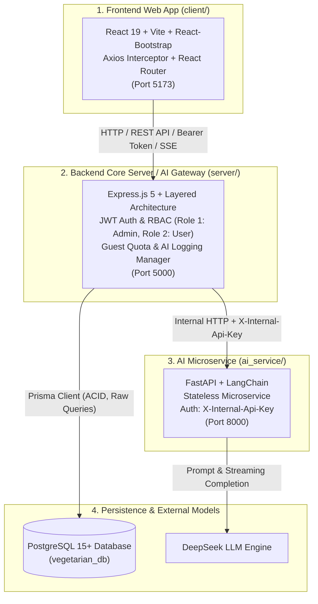

[](https://github.com/minHow14/SWP391/actions/workflows/ci.yml)

# 🌱 Chay Xanh - Nền Tảng Hỗ Trợ Ăn Chay & Sống Khỏe Toàn Diện

> **Dự án SWP391 - FPT University | Software Development Project**  
> Hệ thống tích hợp toàn diện gồm ứng dụng Web SPA (React-Bootstrap), Backend REST API phân tầng (Express + Prisma + PostgreSQL) và AI Microservice tư vấn dinh dưỡng thông minh (FastAPI + LangChain).

---

## 1. 📖 Tên dự án & Bài toán giải quyết

**Chay Xanh** ra đời nhằm hỗ trợ cộng đồng tiếp cận lối sống ăn chay khoa học, lành mạnh và bền vững. Nền tảng kết hợp giữa mạng xã hội ẩm thực, công cụ khám phá món chay, tìm kiếm địa điểm quán ăn chay lân cận, trợ lý ảo AI hỗ trợ lập thực đơn cá nhân hóa và Trung tâm Quản trị (Admin Portal) toàn diện.

### Các bài toán cốt lõi:
1. **Thiếu kiến thức dinh dưỡng cân bằng:** Giải quyết nỗi lo thiếu vi chất (B12, sắt, canxi, protein thực vật) khi chuyển sang chế độ ăn chay.
2. **Khó khăn trong việc lên thực đơn:** Trợ lý AI tự động tính toán nhu cầu calo và đề xuất thực đơn 7 ngày phù hợp với thể trạng, mục tiêu sức khỏe và dị ứng thực phẩm.
3. **Tìm kiếm địa điểm ăn chay:** Định vị nhà hàng, quán chay uy tín xung quanh người dùng dựa trên tọa độ địa lý (GPS).
4. **Kết nối cộng đồng & Kiểm duyệt:** Chia sẻ công thức, nhật ký nấu nướng, video hướng dẫn và tự động kiểm duyệt nội dung độc hại bằng AI kết hợp can thiệp thủ công từ Quản trị viên.

---

## 2. ✨ Tính năng chính

### Phân hệ Người dùng (Member Portal)
- **Tài khoản:** Đăng nhập có tùy chọn ghi nhớ, tự gia hạn access token, đăng xuất xóa refresh cookie. Quên mật khẩu gửi liên kết dùng một lần qua SMTP thật; đặt lại mật khẩu thu hồi các access/refresh token cũ.
- **Kiểm tra món ăn & Quét nhãn thành phần qua hình ảnh (Smart Food & Label Vision Scanner):** Tự động nhận diện đĩa món ăn và bóc tách chữ/mã phụ gia quốc tế (E-numbers) trên bao bì sản phẩm qua AI Vision, đối chiếu theo 5 lớp quy tắc ẩm thực chay (Thịt & hải sản, Phụ phẩm động vật, Trứng/sữa/mật ong, Ngũ vị tân Phật giáo, Dị ứng cá nhân), cảnh báo nguy cơ gia vị ẩn (nước dùng hầm xương, nước mắm) và cung cấp bộ câu hỏi nhanh khi dùng bữa ngoài quán kèm gợi ý đổi món tức thì.
- **Đổi món chay thông minh:** Gợi ý nguyên liệu và món chay thay thế tương đương về cấu trúc dinh dưỡng.
- **Từ điển nguyên liệu chay:** Tra cứu chỉ số calo, đạm, đường, béo và nguồn gốc thực vật.
- **Khám phá công thức & Bản đồ Quán chay:** Định vị GPS thời gian thực (hiệu ứng Radar Pulse), tính khoảng cách kép (`user_distance_m`), hệ thống Hubs đa tỉnh thành (TP.HCM, Hà Nội, Đà Nẵng, Cần Thơ, Huế), tùy chỉnh bán kính quét (3 - 20 km), lọc theo chế độ ăn (Thuần chay, Chay Phật giáo, Chay trứng sữa), tích hợp dịch vụ ZIOMAP kết hợp cơ chế Read-through Caching vào PostgreSQL (<100ms), tự động hiển thị ảnh đại diện và trạng thái mở/đóng cửa (`🟢 Đang mở cửa` / `🔴 Đã đóng cửa`).
- **Nhật ký dinh dưỡng cá nhân:** Ghi nhận khẩu phần calo theo ngày/tuần theo múi giờ địa phương.
- **Lịch sử AI cá nhân:** Mở lại hỏi đáp/thực đơn trong khung chat và kết quả quét ảnh tại trang Kiểm tra món. Lưu món từ kết quả quét phù hợp vào nhật ký sau khi xác nhận khẩu phần và số liệu dinh dưỡng; giá trị chưa biết được để trống.
- **Hồ sơ và chế độ ăn:** Giữ đủ vegan/lacto/ovo/lacto_ovo/buddhist/keto/eat_clean khi gọi AI. Quét ảnh trong trang và chat sử dụng dị ứng đã lưu; đổi chế độ/tài khoản/dị ứng vô hiệu hóa kết quả cũ. BMI trong chat được tính từ số đo thật của hồ sơ. Một ảnh không đủ để xác minh giới hạn carb thuần cả ngày của Keto.
- **Công thức từ video YouTube:** Thành viên dán link video nấu ăn tiếng Việt tối đa 11 phút vào chat. Job chạy nền, lưu công thức vào DB; mở lại chat sau khi tải lại trang sẽ khôi phục tối đa 10 tác vụ gần nhất cùng tác vụ đang xử lý.

### Phân hệ Quản trị viên (Admin Portal - `/admin`)
- **Tổng quan Hệ thống (Dashboard):** Thống kê thời gian thực về thành viên, bài viết, video, tỷ lệ chính xác AI và việc cần xử lý.
- **Quản lý Thành viên:** Tra cứu danh sách, xem bài viết/bình luận của từng thành viên, khóa/mở khóa hoặc xóa tài khoản. Quản trị viên sau khi đăng nhập được tự động chuyển hướng vào Dashboard quản trị.
- **Khôi phục tài khoản:** Dùng thao tác khôi phục riêng, giữ trạng thái kiểm duyệt trước xóa của bài/bình luận. Nội dung cũ thiếu metadata tiếp tục bị xóa và có cảnh báo; không tự công bố lại nội dung ẩn/chờ duyệt.
- **Nội dung pháp lý:** Soạn, lưu nháp hoặc công bố điều khoản/chính sách tại `/admin?tab=legal-documents`. Trang công khai chỉ hiển thị nội dung thật đã công bố; chưa nhập nội dung sẽ báo chưa công bố.
- **Quản lý Bài viết & Video:** Phê duyệt bài đăng mới, chỉnh sửa nội dung vi phạm tiêu chuẩn cộng đồng, gỡ bỏ bài viết.
- **Quản lý Bình luận:** Kiểm tra tương tác, ẩn hoặc xóa bình luận spam/quảng cáo.
- **Quản lý Danh mục:** Thêm, sửa, xóa danh mục món ăn & công thức nấu chay (có kiểm tra ràng buộc dữ liệu).
- **Kiểm duyệt AI:** Worker local kiểm tra văn bản blog/bình luận; Admin xem lý do, bằng chứng và các mục chờ/lỗi, sau đó duyệt hoặc gỡ bằng xóa mềm. Chính sách cho phép sườn chay, món có trứng/sữa; chặn quảng bá thịt/cá. Tính năng cần bật cờ cấu hình.
- **Giám sát Mô hình AI:** Theo dõi trạng thái hoạt động của các mô hình (Gợi ý thực đơn, Chatbot tư vấn, Kiểm duyệt tự động) và tra cứu nhật ký `ai_logs`.
- **Health check quản trị:** Đo kết nối PostgreSQL và HTTP AI Service khi mở trang hoặc bấm kiểm tra lại; không tự polling. Mô hình chưa có log hiển thị “Chưa có dữ liệu”, API trả `UNKNOWN` và `successRate: null`; HTTP AI lên không xác nhận provider inference hoạt động.
- **Can thiệp Thủ công AI:** Ghi nhận điều chỉnh, phản hồi sửa lỗi khi AI đưa ra kết quả chưa chuẩn xác.
- **Quản lý Báo cáo:** Xử lý các phản ánh vi phạm từ người dùng trong cộng đồng.

---

## 3. 🛠️ Công nghệ & Phiên bản cụ thể

| Phân hệ | Công nghệ chính | Phiên bản | Thư viện & Công cụ bổ trợ |
| :--- | :--- | :--- | :--- |
| **Frontend (`client/`)** | React | `19.3.0` | Vite `8.3.3`, React-Bootstrap `2.10.10`, Bootstrap 5, Axios `1.20.0`, React Router `8.4.0`; phiên bản khóa trong `client/package-lock.json` |
| **Backend (`server/`)** | Node.js (ESM), Express | `5.2.1` | Prisma `6.19.3`, Nodemailer `10.3.1`, PostgreSQL, Zod, bcryptjs, jsonwebtoken, Vitest/Supertest; phiên bản khóa trong `server/package-lock.json` |
| **AI Service (`ai_service/`)** | Python ≥3.11, FastAPI `0.159.1` | Pydantic `2.14.1` | LangChain `1.4.7`, DeepSeek API, youtube-transcript-api `1.2.4`, SlowAPI `0.1.10`, Pytest `9.1.1` |
| **Database** | PostgreSQL | `>= 15.0` | Prisma Schema + Migrations, Raw SQL, Connection Pooling |

---

## 4. 🏛️ Kiến trúc tổng quan

Kiến trúc hệ thống tuân thủ mô hình **Microservices với AI Gateway Pattern**. Backend Express đóng vai trò API Gateway duy nhất kiểm soát toàn bộ lưu lượng, xác thực người dùng, giới hạn hạn ngạch (Guest Quota & Rate Limit) và lưu nhật ký (`ai_logs`), đầu vào/prompt/kết quả của thành viên (`ai_generations`). AI Microservice là dịch vụ tính toán phi trạng thái (stateless), tuyệt đối không kết nối trực tiếp vào cơ sở dữ liệu và chỉ giao tiếp với Backend qua khóa nội bộ bảo mật.



---

## 5. 📂 Cấu trúc thư mục

```text
SWP391/
├── client/                     # Frontend React SPA
│   ├── src/
│   │   ├── components/         # Header, Footer, SiteLayout, AuthForm...
│   │   ├── features/admin/     # Các bảng & modal phân rã cho Admin Portal (<250 dòng)
│   │   ├── pages/              # Trang công cộng (Home, Recipes, Community, Profile...)
│   │   │   └── admin/          # Cổng Quản trị AdminPortal & các Tab chức năng
│   │   ├── services/           # apiClient.js, authService.js, workspaceService.js, placeService.js...
│   │   ├── context/            # DatabaseProvider, databaseContext
│   │   ├── hooks/              # Custom hooks (useDatabase, useAuth...)
│   │   ├── utils/              # Tiện ích session, syncEvents, helpers...
│   │   └── App.jsx             # React Router định tuyến (kèm /admin)
│   └── test/                   # Kiểm thử logic FE & Admin
│
├── server/                     # Backend REST API
│   ├── src/
│   │   ├── config/             # Kết nối Prisma Client, cấu hình env
│   │   ├── constants/          # Roles, Status, HttpStatus
│   │   ├── controllers/        # Tiếp nhận request & trả envelope JSON (kèm ai.controller.js)
│   │   ├── middlewares/        # authMiddleware (JWT, RBAC), validation, error
│   │   ├── repositories/       # Nơi duy nhất gọi Prisma Client (tách SRP theo model)
│   │   ├── routes/             # Định tuyến RESTful (/api/ai, /api/v1/ai-generations)
│   │   ├── services/           # Logic nghiệp vụ (kèm ai.service.js, admin.service.js)
│   │   └── utils/              # apiResponse, apiError, jwt
│   ├── prisma/                 # schema.prisma, migrations/, seed.js & seed.sql
│   ├── scripts/                # Script bảo trì: import-ingredient-images, repair, sync-assets
│   └── tests/                  # Kiểm thử tự động Vitest
│
├── ai_service/                 # AI Microservice Python FastAPI (Stateless)
│   ├── agents/                 # Chatbot Agent & Meal Planner Agent
│   ├── api/                    # Routers: /api/chat, /api/meal-planner, /api/admin-actions
│   └── core/                   # Cấu hình DeepSeek LLM, Security (X-Internal-Api-Key), Logging
│
├── docs/                       # Tài liệu thiết kế ERD & OpenAPI
└── README.md                   # Hướng dẫn toàn diện dự án
```

---

## 6. ⚙️ Yêu cầu hệ thống (System Requirements)

- **Node.js:** `>= 22.22.0` & `npm >= 10.x` cho toàn monorepo hiện tại. Quy tắc nền của dự án là Node ≥20, nhưng React Router `8.4.0` trong lockfile yêu cầu Node ≥22.22; Vite `8.3.3` yêu cầu Node `^20.19.0 || >=22.12.0`.
- **Python:** `>= 3.11, < 3.15` với bộ phụ thuộc AI hiện tại.
- **PostgreSQL:** `>= 15.x` (Đang chạy local port `5432`)
- **Hệ điều hành:** Windows, macOS, hoặc Linux

---

## 7. 🚀 Hướng dẫn cài đặt & Khởi động Local từng bước

Mỗi khối lệnh của một service chạy trong **terminal mới tại thư mục gốc repository**. Thư mục Python thực tế là `ai_service/`. Hệ thống chạy trực tiếp trên máy local; không cần thêm hạ tầng triển khai.

Trước khi khởi động, sao chép mẫu nếu file chưa tồn tại và điền cấu hình thật theo Mục 8 (không ghi đè `.env` đã có):

```powershell
if (!(Test-Path server/.env)) { Copy-Item server/.env.example server/.env }
if (!(Test-Path ai_service/.env)) { Copy-Item ai_service/.env.example ai_service/.env }
if (!(Test-Path client/.env)) { Copy-Item client/.env.example client/.env }
```

Thứ tự khởi động: **PostgreSQL 5432 → AI 8000 → Backend 5000 → Frontend 5173**. Thực hiện phần cài dependencies/migration trước; khi chạy local, mở AI trước BE để worker không gặp dịch vụ AI chưa sẵn sàng. SMTP là tùy chọn cho các chức năng khác, bắt buộc nếu cần gửi email khôi phục.

### Bước 1: Khởi tạo Cơ sở dữ liệu PostgreSQL
Mở terminal `psql` hoặc pgAdmin và tạo database:
```sql
CREATE DATABASE vegetarian_db;
```

### Bước 2: Khởi chạy AI Microservice (Port 8000)
```powershell
cd ai_service
python -m venv venv
.\venv\Scripts\python.exe -m pip install -r requirements.txt
# Tạo file .env và điền thông số (đặc biệt INTERNAL_API_KEY và DEEPSEEK_API_KEY) theo Mục 8
.\venv\Scripts\python.exe -m uvicorn main:app --host 127.0.0.1 --port 8000 --reload
```
> AI Service sẽ hoạt động tại: `http://localhost:8000` (Swagger docs: `http://localhost:8000/docs`)

Video dùng phụ đề tiếng Việt có sẵn: ưu tiên bản thủ công, sau đó bản tự động; thiếu phụ đề báo “Video chưa có phụ đề phù hợp”. Không tải audio, không dùng Groq/STT hoặc dịch từ ngôn ngữ khác. `youtube-transcript-api` không cần API key nhưng dùng giao diện không chính thức của YouTube, có thể bị chặn hoặc thay đổi; không đảm bảo tốc độ cố định. DeepSeek vẫn cần key và có chi phí để tạo công thức. Đặt `YT_DLP_PATH` trong `server/.env` thành đường dẫn tuyệt đối tới executable yt-dlp vừa cài (Windows: `ai_service/venv/Scripts/yt-dlp.exe`; Linux/macOS: `ai_service/venv/bin/yt-dlp`), rồi restart BE; yt-dlp chỉ đọc metadata. `npm run dev` / `npm start` của BE tự chạy worker video. Trên Linux/macOS, thay `.\venv\Scripts\python.exe` bằng `./venv/bin/python`. Xem [luồng video](docs/AI_INTEGRATION.md#video-youtube-chạy-nền).

Để bật kiểm duyệt, đặt `CONTENT_MODERATION_ENABLED=true` trong `server/.env`, restart API (worker kiểm duyệt tự chạy cùng `npm run dev`/`npm start`). BE và AI phải dùng cùng `INTERNAL_API_KEY`; AI cần provider key hợp lệ. Giữ mặc định tắt khi chưa cấu hình. Xem [quy trình đầy đủ](docs/CONTENT_MODERATION.md).

### Bước 3: Khởi chạy Backend Server (Port 5000)
```bash
cd server
npm ci --include=optional
# Tạo file .env và điền các thông số theo bảng ở Mục 8
npm run prisma:generate
npx prisma migrate deploy
npm run dev
```
> Server sẽ hoạt động tại: `http://localhost:5000` (Kiểm tra sức khỏe: `http://localhost:5000/health`)

Đăng nhập bằng tài khoản thật đã được cấp trong DB local; DB mới chưa có tài khoản quản trị cần quy trình cấp quyền của nhóm. Lệnh seed hiện tại xóa dữ liệu và chứa dữ liệu demo, không thuộc luồng khởi động mặc định. Không chạy seed để sửa health hoặc ảnh.

Khi chuyển DB đã sửa ảnh sang máy khác, sao chép cả `server/uploads/restaurants/` và `server/uploads/recipes/`; ảnh nguyên liệu nằm trong DB. Git bỏ qua thư mục uploads nên chỉ pull code không khôi phục các ảnh này. Xem [nguồn ảnh và bảo trì](docs/real-image-repairs.md).

Với DB đang có dữ liệu/lịch sử migration cũ, xem [hướng dẫn baseline](docs/AI_INTEGRATION.md) trước khi chạy migrate; không chấp nhận reset.

### Bước 4: Khởi chạy Frontend Web App (Port 5173)
```bash
cd client
npm ci --include=optional
npm run dev
```
> Truy cập ứng dụng tại: `http://localhost:5173`

---

## 8. 🔐 Bảng biến môi trường (Environment Variables)

Tạo file từ `server/.env.example`, `ai_service/.env.example`. Sinh key bằng `node -e "console.log(require('node:crypto').randomBytes(32).toString('hex'))"`; đặt cùng INTERNAL_API_KEY cho BE/AI, JWT_SECRET dùng key khác.

### 1. `server/.env`
| Biến môi trường | Giá trị mặc định / Mẫu | Mô tả |
| :--- | :--- | :--- |
| `PORT` | `5000` | Cổng HTTP của Backend Server |
| `NODE_ENV` | `development` | Môi trường phát triển |
| `CLIENT_URL` | `http://localhost:5173` | Địa chỉ Frontend cho phép CORS |
| `DATABASE_URL` | Theo `server/.env.example`, thay `CHANGE_ME` bằng mật khẩu DB thật | Chuỗi kết nối PostgreSQL qua Prisma; không commit giá trị thật |
| `JWT_SECRET` | `Key ngẫu nhiên riêng của BE` | Khóa bí mật ký mã hóa JWT |
| `JWT_EXPIRES_IN` | `7d` | Thời hạn của Access Token |
| `REFRESH_TOKEN_SECRET` | Rỗng: dùng khóa dẫn xuất từ JWT_SECRET hiện hành | Khóa ký refresh token; có thể cấu hình riêng ở BE, không đưa sang client |
| `REFRESH_TOKEN_EXPIRES_IN` | `30d` | Thời hạn JWT refresh; cookie trình duyệt hiện giữ tối đa 30 ngày |
| `AI_SERVICE_URL` | `http://127.0.0.1:8000` | Địa chỉ nội bộ kết nối tới AI Microservice |
| `INTERNAL_API_KEY` | `Không có mặc định; key ngẫu nhiên ≥32 ký tự` | Khóa bí mật nội bộ truyền qua header `X-Internal-Api-Key` |
| `AI_TIMEOUT_MS` | `180000` | Tổng thời gian chờ AI tối đa trên BE (ms) |
| `YT_DLP_PATH` | `yt-dlp` | Executable lấy metadata video; dùng đường dẫn tuyệt đối khi không có trên PATH |
| `VIDEO_METADATA_TIMEOUT_MS` / `VIDEO_AI_TIMEOUT_MS` | `30000` / `600000` | Deadline metadata / toàn bộ HTTP xử lý AI video (ms) |
| `VIDEO_JOB_LEASE_MS` / `VIDEO_JOB_POLL_MS` | `90000` / `2000` | Lease và chu kỳ nhận job video (ms) |
| `VIDEO_JOB_RETRY_MS` / `VIDEO_JOB_MAX_ATTEMPTS` | `30000` / `3` | Khoảng thử lại lỗi tạm thời (ms) / tổng số lần thử |
| `CONTENT_MODERATION_ENABLED` | `false` | Bật tạo/xử lý job văn bản; API và worker cần cùng cấu hình |
| `CONTENT_MODERATION_TIMEOUT_MS` | `30000` | Deadline HTTP kiểm duyệt (ms), gồm đọc body |
| `CONTENT_MODERATION_MAX_ATTEMPTS` | `3` | Tổng số lần thử mỗi job; lỗi không tự công khai nội dung |
| `GUEST_DAILY_LIMIT`| `3` | Giới hạn số lượt dùng AI miễn phí mỗi ngày cho khách vãng lai |
| `ZIOMAP_API_KEY` | `Key API ZIOMAP` | Tìm kiếm, chi tiết và giải mã ảnh đúng Place ID; chỉ BE gửi header `x-api-key`. Thiếu ảnh trả rỗng, không tạo ảnh mẫu; ảnh local đã tải không cần key |
| `SMTP_HOST` / `SMTP_PORT` | Rỗng / `587` | Host SMTP thật; 587 cho STARTTLS hoặc 465 cho TLS ngay khi kết nối |
| `SMTP_SECURE` | `false` | `false` với 587 (vẫn bắt buộc STARTTLS); `true` với 465. Không tắt xác minh chứng chỉ |
| `SMTP_USER` / `SMTP_PASS` | Rỗng | Thông tin xác thực do nhà cung cấp email cấp; chỉ lưu local ở BE |
| `SMTP_FROM` | Rỗng | Địa chỉ email người gửi đã được nhà cung cấp cho phép, không phải chuỗi tên hiển thị |
| `PASSWORD_RESET_TTL_MINUTES` | `15`, miền `5..60` | Thời hạn link khôi phục mới; link dùng CLIENT_URL và token trong URL fragment |
| `RATE_LIMIT_MAX` / `AUTH_RATE_LIMIT_MAX` / `PLACES_RATE_LIMIT` | `300` / `15` / `60` | Giới hạn request toàn cục / xác thực / places; cửa sổ hiện hành xem middleware tương ứng |

### 2. `ai_service/.env`
| Biến môi trường | Giá trị mặc định / Mẫu | Mô tả |
| :--- | :--- | :--- |
| `INTERNAL_API_KEY` | `Không có mặc định; key ngẫu nhiên ≥32 ký tự` | Khóa so khớp với Backend qua header `X-Internal-Api-Key` |
| `DEEPSEEK_API_KEY` | `sk-xxxxxxxxxxxxxxxx` | Khóa kết nối API DeepSeek LLM Engine |
| `DEEPSEEK_MODEL` | `deepseek-chat` | Mô hình ngôn ngữ mặc định |
| `DEEPSEEK_FALLBACK_MODEL` | `deepseek-v4-pro` | Model dự phòng; model xử lý Food Scanner phải hỗ trợ đầu vào hình ảnh |
| `VIDEO_CAPTIONS_TIMEOUT_SECONDS` | `30` | Budget lấy phụ đề (giây, >0 đến 120); đọc HTTP từng phần với socket timeout tối đa 5 giây, mỗi response tối đa 4 MiB |
| `VIDEO_SUMMARY_TIMEOUT_SECONDS` | `120` | Deadline gọi model tạo công thức (giây, >0 đến 300) |
| `CONTENT_MODERATION_TIMEOUT_SECONDS` | `20` | Deadline inference kiểm duyệt (giây); nên ngắn hơn timeout worker |
| `DEBUG` | `False` | Chế độ debug |
| `ALLOWED_ORIGINS` | `http://localhost:5000` trong mẫu | Danh sách origin cho phép; frontend gọi AI qua BE |
| `TRUSTED_PROXIES` | `127.0.0.1,::1` | Proxy tin cậy theo cấu hình AI hiện hành |
| `RATE_LIMIT` | `30/minute` | Giới hạn request ở AI Service |

### 3. `client/.env`
| Biến môi trường | Giá trị mặc định / Mẫu | Mô tả |
| :--- | :--- | :--- |
| `VITE_API_URL` | `/api` | Base path của fetch/SSE AI; Axios dùng `/api` cố định. Giữ `/api` khi chạy local để cùng origin/cookie và cùng refresh session |

Vite proxy `/api` và `/uploads` tới `http://127.0.0.1:5000` trong `client/vite.config.js`. Đổi riêng VITE_API_URL không đổi các service Axios. Không đặt JWT/SMTP/provider key hoặc INTERNAL_API_KEY trong biến `VITE_*`.

Sau khi điền SMTP thật, restart BE. Thiếu cấu hình hoặc không verify được SMTP trả `503 PASSWORD_RESET_UNAVAILABLE` đồng nhất. Phản hồi `200` chỉ xác nhận xử lý yêu cầu chung, không xác nhận email tồn tại hoặc đã giao thành công; lỗi gửi sau verify thu hồi link và ghi mã lỗi không chứa token/mật khẩu. Chưa có bảo đảm thời gian phản hồi ngang nhau giữa email tồn tại/không tồn tại.

Để công bố nội dung pháp lý, đăng nhập bằng admin thật → tab **Nội dung pháp lý** → chọn tài liệu → nhập nội dung đã được phê duyệt → bật công bố → lưu. Kiểm tra `/dieu-khoan` và `/chinh-sach-bao-mat` không cần đăng nhập. Không có văn bản mẫu tự điền.

---

## 9. 📜 Danh sách Scripts

### Backend (`server/`)
- `npm run dev`: Chạy server ở chế độ giám sát tự tải lại (nodemon).
- `npm start`: Khởi động server production.
- `npm test`: Chạy Vitest/Supertest trên DB `_test` (AI Gateway, lưu prompt/kết quả, quota, Repository, Quản trị & RBAC).
- `npm run test:prepare`: Tạo/reset schema public của DB local `_test`, apply migrations và seed SQL.
- `npm run prisma:migrate -- --name <ten_thay_doi>`: Sinh/áp dụng migration local bằng Prisma Migrate.
- `npm run prisma:generate`: Tạo mã nguồn Prisma Client.
- Không dùng `prisma db push` cho DB có dữ liệu cần giữ; dùng Prisma Migrate.
- `npm run seed` / `npm run db:seed`: Áp dụng migration còn thiếu rồi nạp `seed.sql`; xóa dữ liệu cũ.
- `npm run worker:content-moderation`: Chạy thêm worker kiểm duyệt độc lập (tùy chọn, API đã tự chạy một worker); cần bật cờ cấu hình.
- `npm run worker:video-recipes`: Worker video độc lập tùy chọn; API đã tự chạy worker. Cùng DB được bảo vệ bằng lease khi có nhiều worker.
- `npm run test:video-recipes`: Kiểm thử pipeline video trên DB test.
- `node tests/videoRecipeSummaryCaptions.integration.mjs`: Kiểm tra video thật → phụ đề → DeepSeek → DB `_test`, gồm retry và thiếu phụ đề; chạy riêng, có thể tính phí provider.
- `npm run test:ai-internal-auth`: Kiểm thử HTTP BE → FastAPI thật bằng runtime test, không gọi provider.
- `npm run test:content-moderation`: Kiểm thử API/DB/worker/HTTP kiểm duyệt và migration/seed trên DB test.
- `npm run db:repair-ingredients`: Cập nhật chi tiết dinh dưỡng nguyên liệu từ catalog chuẩn (`scripts/repair-ingredients.js`).
- `npm run db:import-ingredient-images`: Tải và lưu trữ binary ảnh nguyên liệu vào PostgreSQL (`scripts/import-ingredient-images.js`).
- `node scripts/repairRestaurantImages.js`: Chuẩn bị ảnh đúng Google Place ID và manifest, chưa ghi DB; chỉ dùng khi còn mã ảnh chưa giải quyết. `--apply` kiểm tra hash rồi cập nhật có điều kiện trong transaction. Xem [quy trình bảo trì](docs/real-image-repairs.md) trước khi chạy.
- `npm run test:real-images`: Kiểm tra hash, ảnh trùng và HTTP cho ảnh quán/công thức đã tải; chạy riêng sau khi khôi phục uploads, không nằm trong `npm test` mặc định.
- `npm run assets:sync`: Đồng bộ nguồn ảnh nguyên liệu từ Wikimedia (`scripts/sync-ingredient-assets.js`).

### Frontend (`client/`)
- `npm run dev`: Khởi động Vite dev server.
- `npm run build`: Đóng gói ứng dụng thành phẩm (Production build).
- `npm test`: Chạy test logic/service với Node.js Test Runner (`test/*.test.js`).
- `npm run test:ui`: Chạy toàn bộ `test/*.test.jsx` bằng Vitest/React Testing Library, gồm auth, scanner, chat, admin, cộng đồng và job.
- `npm run lint`: Kiểm tra ESLint; cảnh báo effect bản đồ được giải thích ở Mục 13.
- `npm run preview`: Chạy thử bản build đã đóng gói trên máy local.

### AI Microservice (`ai_service/`)
- `.\venv\Scripts\python.exe -m uvicorn main:app --host 127.0.0.1 --port 8000 --reload`: Khởi động FastAPI bằng đúng venv; Linux/macOS dùng `./venv/bin/python`.
- `pytest`: Chạy các kiểm thử tự động với Pytest (bao gồm Chatbot Agent, Meal Planner SSE stream, Xác thực X-Internal-Api-Key, Tính toán Dinh dưỡng & Rate Limiting).


---

## 10. 📚 Link tài liệu API & ERD

- **Khôi phục mật khẩu, refresh, pháp lý và restore tài khoản:** [`docs/frontend-repairs-openapi.json`](docs/frontend-repairs-openapi.json).
- **Video/phụ đề nội bộ AI:** [`docs/video-recipe-ai-openapi.json`](docs/video-recipe-ai-openapi.json); API job công khai nằm trong [`docs/ai-openapi.json`](docs/ai-openapi.json).
- **Kết quả rà soát và kiểm chứng:** [audit](docs/frontend-audit-2026-11-03.md), [Phase 1](docs/frontend-repairs-phase1.md), [Phase 2](docs/frontend-repairs-phase2.md), [Phase 3 và hai cảnh báo bản đồ](docs/frontend-repairs-phase3.md).

- **Health quản trị & AI chưa có dữ liệu:** [`docs/admin-health-openapi.json`](docs/admin-health-openapi.json).
- **Ảnh đã xác minh, nguồn và cách chuyển máy:** [`docs/real-image-repairs.md`](docs/real-image-repairs.md), [ảnh quán](docs/restaurant-image-sources.json), [ảnh công thức](docs/recipe-image-sources.json).
- **AI Gateway, persistence & migration:** [`docs/AI_INTEGRATION.md`](docs/AI_INTEGRATION.md), [`docs/ai-openapi.json`](docs/ai-openapi.json).
- **Kiểm duyệt cộng đồng:** [`docs/CONTENT_MODERATION.md`](docs/CONTENT_MODERATION.md), [`docs/content-moderation-openapi.json`](docs/content-moderation-openapi.json).
- **Tài liệu ERD Database:** Lưu trữ tại [`docs/ERD.md`](docs/ERD.md)

- **Tài liệu Swagger / OpenAPI:** Truy cập trực tiếp tại `http://localhost:8000/docs` khi AI Service khởi chạy.
- **Quy chuẩn lập trình:** Chi tiết tại [`AGENTS.md`](AGENTS.md), [`server/AGENTS.md`](server/AGENTS.md), [`client/AGENTS.md`](client/AGENTS.md), và [`ai_service/AGENTS.md`](ai_service/AGENTS.md).

---

## 11. 🧪 Hướng dẫn chạy Test trên DB Test riêng

Backend bắt buộc nạp `.env.test`, tên DB kết thúc bằng `_test`. Không dùng DB phát triển để chạy test.

```powershell
cd server
if (!(Test-Path .env.test)) { Copy-Item .env.test.example .env.test }
# Điền DATABASE_URL, JWT_SECRET, INTERNAL_API_KEY và PSQL_PATH trong .env.test.
# JWT_SECRET và INTERNAL_API_KEY dùng giá trị ngẫu nhiên riêng cho test.
npm run test:prepare
npm test
npm run test:database
```

Kiểm tra riêng health/RBAC, timeout và ảnh đã sửa (từ `server/`, với `.env.test` đã cấu hình và ảnh trong uploads đã được sao chép):

```powershell
npx vitest run tests/adminHealthApi.test.js tests/adminHealth.test.js tests/adminModelStatus.test.js tests/restaurantImageRepair.test.js tests/placePhoto.test.js tests/placePhotoResolution.test.js tests/ingredientImageImport.test.js tests/places.test.js
npm run test:real-images
```

`test:real-images` đọc hai manifest, kiểm tra hash duy nhất và HTTP phục vụ ảnh local, không tải Internet hay ghi DB. `adminHealthApi.test.js` xác thực bằng DB `_test` thật và dùng HTTP fixture local cho tình huống AI lên/lỗi/treo; không cần inference provider. Test ảnh yêu cầu file binary đã sửa, không tự sinh ảnh thay thế khi thiếu file. Bộ `npm test` mặc định không phụ thuộc uploads đã tải trên máy này.

`test:prepare` reset schema public của DB test local, áp dụng migration thật rồi seed SQL. Integration ảnh (`npm run test:ingredient-images`) cần 28 ảnh nguyên liệu thật được import vào DB test; xem tài liệu AI integration. Mỗi file test chạy tuần tự để tránh xung đột fixture cũ.

Chỉ chạy `test:prepare` khi chủ đích khởi tạo lại DB test có thể xóa. Để **giữ DB test hiện có** và chỉ áp dụng migration, chạy từ `server/`:

```powershell
node --input-type=module -e 'await import("./tests/loadTestEnvironment.js"); const {execFileSync}=await import("node:child_process"); execFileSync(process.execPath,["node_modules/prisma/build/index.js","migrate","deploy"],{stdio:"inherit"});'
```

Kiểm tra riêng các hợp đồng vừa sửa, không cần inference hoặc SMTP thật:

```powershell
npx vitest run tests/frontendAuthIntegration.test.js tests/passwordResetApi.test.js tests/tokenVersion.test.js tests/legalDocuments.test.js tests/adminAccountRestore.test.js
```

`frontendAuthIntegration.test.js` dùng client Axios/authService thật → Express HTTP loopback → Prisma/PostgreSQL `_test`. Chỉ SMTP transport được thay thế trong test; Node giả lập cookie jar của trình duyệt bằng header ở phía test. Bao phủ gửi link → parse fragment → đổi mật khẩu → từ chối dùng lại/phiên cũ → đăng nhập mới, refresh cùng tài khoản và từ chối cookie khác tài khoản trước khi ghi dữ liệu. Tự xóa fixture do file tạo; không khởi động worker hay gửi mail thật.

```powershell
cd ../client
npm test
npm run test:ui
npm run lint
npm run build
cd ../ai_service
.\venv\Scripts\python.exe -m pytest tests -q
.\venv\Scripts\python.exe -m ruff check agents api core schemas main.py tests
```

Provider được thay thế chỉ trong test; test không gọi DeepSeek thật. Nếu Vitest gặp lỗi worker trong môi trường giới hạn, dùng `npm run test:ui -- --pool=threads --maxWorkers=1 --no-file-parallelism`. Các file `.env`, `.env.test` không được commit.

Kiểm tra video thật chạy riêng, ngoài các suite mặc định: khởi động AI bằng venv, cấu hình cùng khóa nội bộ và DeepSeek hợp lệ, bảo đảm không có worker/suite khác dùng hàng chờ DB test, rồi chạy từ `server/`:

```powershell
node tests/videoRecipeSummaryCaptions.integration.mjs
```

Script giữ nguyên `DATABASE_URL` của `.env.test` (bắt buộc loopback và hậu tố `_test`), chỉ đọc cấu hình kết nối AI/khóa nội bộ/metadata executable từ `server/.env`. Nó dùng video thật, gọi DeepSeek có tính phí, xác minh lỗi xác thực → endpoint thử lại → lưu công thức, và video không có phụ đề Việt; sau đó tự xóa fixture riêng. Không chạy trên DB phát triển và không trả kết quả giả khi nguồn/provider lỗi. Xem [chi tiết kiểm thử video](server/docs/videoRecipeSummaryBackend.md#verification).

Nếu môi trường hạn chế báo ENOENT ở thư mục tạm, đặt TEMP/TMP vào cache workspace trước khi chạy Vitest (thực hiện riêng trong `client/` hoặc `server/`):

```powershell
New-Item -ItemType Directory -Force node_modules/.cache/frontend-repairs | Out-Null
$env:TEMP = Join-Path (Get-Location) 'node_modules/.cache/frontend-repairs'
$env:TMP = $env:TEMP
```

Test tự động không chứng minh email đã tới hộp thư hoặc chất lượng kết quả từ provider thật. Kiểm chứng hai phần này cần cấu hình/tài khoản thật riêng.

---

## 12. 📐 Quy ước Code & Git

- **Quy chuẩn mã nguồn:**
  - Không dữ liệu giả (`No Mock Data`) trong code chạy thật.
  - Xử lý đủ 4 trạng thái UI: `loading`, `error`, `empty`, `success`.
  - Component React $\le 250$ dòng, hàm JS $\le 30$ dòng, tham số $\le 3$.
- **Quy ước đặt tên (FE ↔ BE ↔ DB):**
  - Model Prisma: `PascalCase` (`User`, `Post`, `Comment`).
  - Bảng Database: `snake_case` số nhiều (`@@map("users")`, `@@map("posts")`).
  - Cột Database: `snake_case` (`@map("created_at")`, `@map("user_id")`).
  - JSON API: `camelCase` (`userId`, `createdAt`).
- **Quy ước Commit:** Theo chuẩn Conventional Commits: `feat:`, `fix:`, `docs:`, `refactor:`, `test:`, `chore:`.
- **Nhánh cho đợt sửa này:** `fix-frontend`, giữ một nhánh và commit riêng theo chức năng theo yêu cầu người dùng. Quy tắc nhánh chung cho công việc khác vẫn xem AGENTS.md.

---

## 13. 🔧 Troubleshooting các lỗi thường gặp

1. **Lỗi `P1001: Can't reach database server at localhost:5432`:**
   - *Nguyên nhân:* Dịch vụ PostgreSQL chưa khởi động hoặc sai thông tin mật khẩu trong `DATABASE_URL`.
   - *Khắc phục:* Mở `Services` trên Windows, kiểm tra dịch vụ `postgresql-x64-15` đang ở trạng thái `Running`. Kiểm tra lại user/password trong file `.env`.
2. **Lỗi 403 Forbidden khi truy cập `/api/admin/*`:**
   - *Nguyên nhân:* Đang dùng tài khoản thành viên thông thường (Role 2).
   - *Khắc phục:* Đăng nhập bằng tài khoản quản trị thật đang hoạt động trong DB; role trong DB quyết định quyền truy cập.
3. **Lỗi 401 Unauthorized khi Backend gọi AI Service:**
   - *Nguyên nhân:* `INTERNAL_API_KEY` trong `server/.env` không khớp với `INTERNAL_API_KEY` trong `ai_service/.env`.
   - *Khắc phục:* Kiểm tra và đồng bộ giá trị khóa bí mật giữa hai file môi trường.
4. **Lỗi `ReferenceError: window is not defined` khi chạy test Frontend:**
   - *Nguyên nhân:* Môi trường Node.js không có sẵn đối tượng browser.
   - *Khắc phục:* Đảm bảo các file test có mock `globalThis.window` và `sessionStorage` tương thích trước khi gọi hàm.
5. **Nội dung kiểm duyệt chờ mãi hoặc job `FAILED`:** Kiểm tra cờ bật, worker chạy đúng DB, khóa nội bộ và provider key. Không seed/reset DB để sửa hàng chờ; Admin có thể duyệt/gỡ thủ công. Xem [bảng lỗi kiểm duyệt](docs/CONTENT_MODERATION.md#xử-lý-sự-cố).
6. **Video chờ hoặc lỗi phụ đề:** `PENDING` cần BE/worker đang chạy đúng DB; `VALIDATING_VIDEO` cần `YT_DLP_PATH` và kết nối YouTube; `FETCHING_CAPTIONS` cần phụ đề Việt. `VIDEO_CAPTIONS_UNAVAILABLE` báo “Video chưa có phụ đề phù hợp”; `VIDEO_CAPTIONS_BLOCKED` là YouTube chặn truy cập, không đồng nghĩa thiếu phụ đề. `VIDEO_CAPTIONS_TIMEOUT` được thử lại có giới hạn. Dùng nút “Thử tạo lại” hoặc endpoint `/retries` cho job đã lỗi. Khởi động AI bằng Python của venv để tránh thiếu thư viện; không seed/reset DB để xử lý hàng chờ. Xem [luồng video](docs/AI_INTEGRATION.md#video-youtube-chạy-nền).
7. **Food Scanner báo lỗi hoặc chưa kết luận:** Ảnh tối đa 10 MiB, JPEG/PNG/WebP; model phải hỗ trợ ảnh. Lỗi AI không tạo kết quả thành công giả. `nutritionEstimate=null` nghĩa là chưa có số liệu, không phải 0. Xem [hợp đồng quét ảnh](docs/AI_INTEGRATION.md#quét-ảnh-và-lưu-nhật-ký).
8. **Health báo AI DOWN hoặc “Chưa có dữ liệu”:** Kiểm tra AI Service port 8000, `AI_SERVICE_URL` và khóa nội bộ; sau đó bấm “Kiểm tra lại”. `UNKNOWN` của mô hình nghĩa là chưa có log phù hợp, không phải lỗi hay tỷ lệ thành công 0%. DB lỗi có thể chặn xác thực admin trước khi chạy probe.
9. **Ảnh trống sau khi chuyển máy:** Khôi phục đúng thư mục uploads cùng DB, giữ nguyên tên file/hash trong manifest. Không chạy seed hoặc thay bằng ảnh stock; ảnh nguồn không lấy được được để trống. Tám ảnh công thức có nhãn “Ảnh món ăn tham khảo” vì có thể khác biến thể nguyên liệu.
10. **CI seed dừng với `P3005: The database schema is not empty`:** Workflow phải tạo schema bằng `npx prisma migrate deploy` trước `npm run seed`. Không chạy `prisma db push` trước migration vì nó tạo bảng mà không ghi lịch sử migration. Test seed đọc trực tiếp các lệnh setup DB từ workflow và chạy trên DB tạm mới để bắt lỗi này. Với DB đang có dữ liệu cần giữ, kiểm tra drift và baseline theo [hướng dẫn migration](docs/AI_INTEGRATION.md), không reset hoặc tự đánh dấu migration đã áp dụng.
11. **Quên mật khẩu báo chưa sẵn sàng:** Kiểm tra SMTP_HOST/PORT/SECURE/USER/PASS/FROM, quyền người gửi, mạng và CLIENT_URL. Link dùng HTTPS ngoài loopback local. Không đưa token vào query string/log; yêu cầu link mới nếu hết hạn hoặc đã dùng. Nếu DB còn dùng mật khẩu admin seed từng công khai, chủ tài khoản cần đổi bằng luồng đổi mật khẩu.
12. **Điều khoản báo chưa công bố:** Admin cần nhập và công bố nội dung được duyệt. Lưu nháp không hiển thị công khai; không dùng seed để tạo văn bản pháp lý.
13. **Khôi phục tài khoản có cảnh báo nội dung:** Tài khoản đã phục hồi nhưng bài/bình luận cũ thiếu trạng thái trước xóa sẽ tiếp tục DELETED. Không đoán trạng thái gốc; xem số lượng trong `data.restoration` và `data.warning`.
14. **ESLint có hai cảnh báo ở RestaurantMap.jsx:** Effect khởi tạo bản đồ đọc `userLocation` nhưng dependency là `[]`; effect vẽ marker/bán kính đọc cả object `userLocation`/`searchCenter` trong khi dependency liệt kê các trường tọa độ. Đây là `react-hooks/exhaustive-deps`, không phải lỗi biên dịch hoặc bằng chứng API bản đồ chưa nối. Xem giải thích và giới hạn trong báo cáo Phase 3; không thêm object vào effect khởi tạo một cách máy móc vì có thể tạo lại bản đồ mỗi lần vị trí đổi.
15. **Build cảnh báo chunk lớn:** Bundle chính trên 500 kB trước gzip; build vẫn thành công. Đây là cảnh báo kích thước tải JS, độc lập với hai cảnh báo dependency bản đồ.
16. **Cài npm báo tarball corrupted, cache `ENOENT`, hoặc Rolldown không nạp được native binding trên Windows:**
    - Dừng Vite/nodemon bằng `Ctrl+C` trong terminal đang chạy trước khi cài lại để tránh file bị giữ (`EPERM`). Giữ nguyên `package-lock.json`; sau khi clone dùng `npm ci --include=optional` để cài đúng phiên bản đã khóa và các gói native phù hợp máy.
    - Chạy `npm cache verify`. Nếu lỗi cache vẫn lặp lại nhưng cài bằng cache mới thành công, đặt một cache mới cố định cho tài khoản (lệnh dưới đây thay đổi cache cho tất cả dự án npm của tài khoản), rồi cài lại lần lượt trong `server/` và `client/`:

      ```powershell
      npm config set cache "$env:LOCALAPPDATA\npm-cache-repaired" --location=user
      npm ci --include=optional --prefer-online
      ```

    - Trong `server/`, chạy thêm `npm run prisma:generate`. npm 12 yêu cầu cho phép script cài đặt; `server/package.json` đã cho phép đúng `@prisma/client`, `@prisma/engines`, `prisma` phiên bản `6.19.3`. Khi chủ động nâng Prisma, kiểm tra script rồi chạy `npm install-scripts approve @prisma/client @prisma/engines prisma`, commit thay đổi cùng lockfile. Xem [npm ci](https://docs.npmjs.com/cli/v12/commands/npm-ci/), [cache](https://docs.npmjs.com/cli/v12/commands/npm-cache/), [quyền chạy script](https://docs.npmjs.com/cli/v12/commands/npm-install-scripts/).
    - Cảnh báo `npm audit` là vấn đề dependency riêng; xem báo cáo trước khi cập nhật, không dùng `npm audit fix --force` để sửa lỗi cache. Nếu cache mới cũng tiếp tục mất/hỏng file, kiểm tra lịch sử cách ly của antivirus, phần mềm dọn cache và ổ đĩa; chưa thể kết luận nguyên nhân chỉ từ log npm.

---

## 14. 📄 License & Thông tin liên hệ

- **Dự án học tập:** SWP391 - Kỹ thuật phần mềm (FPT University).
- **Nhóm phát triển:** Đội ngũ Kỹ sư Chay Xanh SWP391.
- **Bản quyền:** Mã nguồn phục vụ mục đích nghiên cứu và phát triển học thuật.
- **License:** Repository chưa có file LICENSE ở gốc; `server/package.json` khai báo ISC cho package backend, không đủ để suy ra giấy phép toàn monorepo.
- **Liên hệ/báo lỗi:** [Issues của repository](https://github.com/minHow14/SWP391/issues). Không có email liên hệ được xác nhận trong cấu hình dự án.
