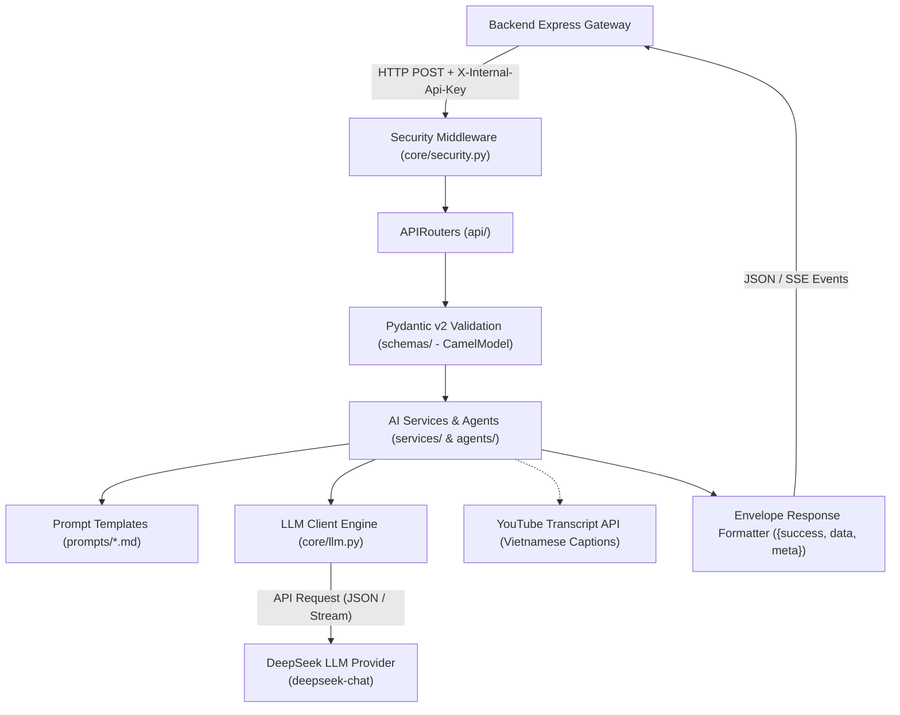

# 🧠 Tài Liệu Kỹ Thuật Phân Hệ AI Service - Chay Xanh

> **Dự án:** SWP391 - Vegetarian & Healthy Platform (Chay Xanh)  
> **Kiến trúc:** Stateless AI Microservice + LangChain Orchestration  
> **Ngăn xếp công nghệ:** Python 3.11+ + FastAPI 0.159 + Pydantic v2 + DeepSeek LLM + Pytest  
> **Điều hướng liên kết:** [Tổng quan dự án](../README.md) | [Tài liệu Frontend](../client/README.md) | [Tài liệu Backend](../server/README.md)

---

## 📑 Mục lục (Table of Contents)

1. [Tổng quan phân hệ AI Service (AI Service Overview)](#1-tổng-quan-phân-hệ-ai-service-ai-service-overview)
2. [Ngăn xếp công nghệ thực tế (Technology Stack)](#2-ngăn-xếp-công-nghệ-thực-tế-technology-stack)
3. [Kiến trúc phân tầng AI (AI Architecture)](#3-kiến-trúc-phân-tầng-ai-ai-architecture)
4. [Cấu trúc thư mục chi tiết (Project Structure)](#4-cấu-trúc-thư-mục-chi-tiết-project-structure)
5. [Cấu trúc ứng dụng FastAPI (FastAPI Application Structure)](#5-cấu-trúc-ứng-dụng-fastapi-fastapi-application-structure)
6. [Danh mục API Endpoints thực tế (API Endpoints)](#6-danh-mục-api-endpoints-thực-tế-api-endpoints)
7. [Mô hình dữ liệu Pydantic v2 (Request & Response Schemas)](#7-mô-hình-dữ-liệu-pydantic-v2-request--response-schemas)
8. [Tích hợp Mô hình Ngôn ngữ Lớn (LLM Integration & DeepSeek)](#8-tích-hợp-mô-hình-ngôn-ngữ-lớn-llm-integration--deepseek)
9. [Kỹ nghệ thiết kế Prompt (Prompt Engineering)](#9-kỹ-nghệ-thiết-kế-prompt-prompt-engineering)
10. [Các quy trình xử lý AI cốt lõi (AI Processing Workflows)](#10-các-quy-trình-xử-lý-ai-cốt-lõi-ai-processing-workflows)
11. [Giao tiếp bảo mật với Backend (Backend Communication)](#11-giao-tiếp-bảo-mật-với-backend-backend-communication)
12. [Bảng biến môi trường (Environment Variables)](#12-bảng-biến-môi-trường-environment-variables)
13. [Hướng dẫn cài đặt & Khởi động (Installation & Setup)](#13-hướng-dẫn-cài-đặt--khởi-động-installation--setup)
14. [Danh mục lệnh phát triển (Development Commands)](#14-danh-mục-lệnh-phát-triển-development-commands)
15. [Chiến lược kiểm thử tự động (Testing với Pytest)](#15-chiến-lược-kiểm-thử-tự-động-testing-với-pytest)
16. [Chiến lược xử lý lỗi & Phục hồi (Error Handling)](#16-chiến-lược-xử-lý-lỗi--phục-hồi-error-handling)
17. [Quy chuẩn bảo mật AI Service (Security Notes)](#17-quy-chuẩn-bảo-mật-ai-service-security-notes)
18. [Xử lý sự cố thường gặp (Troubleshooting)](#18-xử-lý-sự-cố-thường-gặp-troubleshooting)

---

## 1. Tổng quan phân hệ AI Service (AI Service Overview)

Phân hệ **AI Service** của Chay Xanh là một vi dịch vụ độc lập (Microservice), chuyên trách thực thi các tác vụ trí tuệ nhân tạo, xử lý ngôn ngữ tự nhiên (NLP) và thị giác máy tính (Computer Vision) phục vụ dinh dưỡng chay.

### Đặc điểm kiến trúc cốt lõi:
- **Nguyên tắc Stateless (Phi trạng thái):** Dịch vụ **tuyệt đối không kết nối trực tiếp vào PostgreSQL**. Mọi dữ liệu người dùng, hồ sơ dị ứng và thông tin món ăn đều do Backend truyền sang qua HTTP request body.
- **Không phân quyền người dùng:** Dịch vụ AI không giải mã JWT token và không sở hữu thông tin Role. Backend chịu trách nhiệm xác thực danh tính người dùng trước khi gọi sang AI.
- **Bảo mật giao tiếp nội bộ:** Mọi endpoint (trừ `GET /health`) bắt buộc phải có header `X-Internal-Api-Key` khớp với biến môi trường `INTERNAL_API_KEY`.
- **Cấm dữ liệu giả (No Mock Data):** Nếu mô hình AI hoặc API nhà cung cấp gặp sự cố, dịch vụ sẽ ném ngoại lệ rõ ràng (`503 Service Unavailable`), tuyệt đối không tự bịa đặt dữ liệu dinh dưỡng hoặc thành phần giả để trả về.

---

## 2. Ngăn xếp công nghệ thực tế (Technology Stack)

Đối chiếu trực tiếp từ `ai_service/requirements.txt`:

| Thư viện / Công nghệ | Phiên bản | Mục đích & Trách nhiệm |
| :--- | :--- | :--- |
| **Python** | `>= 3.11, < 3.15` | Ngôn ngữ lập trình chính cho phân hệ AI. |
| **FastAPI** | `0.159.1` | Web framework bất đồng bộ (Asynchronous) hiệu năng cao chuẩn ASGI. |
| **Uvicorn** | `0.54.0` | Máy chủ ASGI Server chạy ứng dụng FastAPI. |
| **Pydantic & Settings** | `2.14.1` / `2.16.1` | Khai báo Schema kiểm thực dữ liệu đầu vào/ra và nạp biến môi trường. |
| **LangChain Core & Community**| `1.4.7` / `1.6.13` | Bộ khung điều phối chuỗi xử lý Prompt, Context và tích hợp LLM. |
| **LangChain OpenAI**| `1.7.2` | Bộ chuyển đổi tương thích giao thức OpenAI API kết nối tới DeepSeek LLM. |
| **HTTPX** | `0.28.1` | HTTP Client bất đồng bộ hỗ trợ streaming và kết nối mạng. |
| **SSE-Starlette** | `3.5.0` | Thư viện phát luồng sự kiện Server-Sent Events (SSE) cho Chatbot & Meal Planner. |
| **SlowAPI** | `0.1.10` | Middleware giới hạn tần suất request (Rate Limiting) trên từng endpoint. |
| **youtube-transcript-api** | `1.2.4` | Trích xuất phụ đề tiếng Việt có sẵn từ video YouTube. |
| **RapidFuzz & Unidecode**| `3.14.6` / `1.4.0` | So khớp mờ (Fuzzy matching) tên nguyên liệu và chuẩn hóa tiếng Việt không dấu. |
| **Pytest & Pytest-Asyncio**| `9.1.1` / `1.4.0` | Khung kiểm thử đơn vị và tích hợp bất đồng bộ cho ứng dụng FastAPI. |
| **Ruff** | `0.17.1` | Bộ công cụ kiểm tra cú pháp và định dạng mã nguồn siêu tốc chuẩn PEP 8. |

---

## 3. Kiến trúc phân tầng AI (AI Architecture)



---

## 4. Cấu trúc thư mục chi tiết (Project Structure)

```text
ai_service/
├── agents/                    # Các Agent đóng gói logic nghiệp vụ AI chuyên biệt
│   ├── chatbot_agent.py       # Trợ lý ảo tư vấn dinh dưỡng chay
│   ├── meal_planner_agent.py  # Thuật toán tính toán TDEE và lập thực đơn 7 ngày
│   ├── food_scanner_agent.py  # Xử lý nhận diện món ăn và nhãn thành phần qua ảnh
│   └── vision_agent.py        # Logic nhận diện nguyên liệu tủ lạnh (tính năng dự thảo)
│
├── api/                       # Định nghĩa các APIRouter của FastAPI
│   ├── chat.py                # Endpoint /api/chat và /api/chat/stream
│   ├── meal_planner.py        # Endpoint /api/meal-planner/generate (/stream)
│   ├── food_scanner.py        # Endpoint /api/food-scanner/analyze
│   ├── video_recipe.py        # Endpoint /api/video-recipe-transcriptions & summaries
│   ├── content_moderation.py  # Endpoint /api/v1/content-moderations
│   ├── image_moderation.py    # Endpoint /api/v1/image-moderations (kiểm duyệt từng ảnh bài đăng)
│   ├── ingredient_lookup.py   # Endpoint /api/ingredient-lookup
│   ├── admin_actions.py       # Endpoint /api/admin/chatbot-cache/clear
│   └── vision.py              # Endpoint dự thảo nhận diện nguyên liệu (chưa mount vào main.py)
│
├── core/                      # Hạt nhân hệ thống, bảo mật, cấu hình và LLM
│   ├── config.py              # Cấu hình Pydantic BaseSettings đọc file .env
│   ├── security.py            # Middleware xác thực X-Internal-Api-Key
│   ├── llm.py                 # Khởi tạo instance kết nối DeepSeek LLM
│   ├── ratelimit.py           # Thiết lập bộ giới hạn SlowAPI
│   ├── prompt_trace.py        # Lưu vết snapshot prompt phục vụ kiểm toán
│   ├── dietary.py             # Định nghĩa danh mục chế độ ăn chay chuẩn
│   └── nutrition.py           # Công thức toán học tính BMI, BMR, TDEE và Macro
│
├── prompts/                   # Kho lưu trữ System Prompts dưới định dạng Markdown
│   ├── chatbot.md             # Hướng dẫn phong cách trả lời cho Trợ lý ảo
│   ├── meal_planner.md        # Quy tắc cân đối calo, tỷ lệ đạm/béo/đường theo ngày
│   ├── food_scanner.md        # 5 lớp kiểm tra thành phần chay và chất phụ gia
│   ├── video_recipe.md        # Khuôn mẫu bóc tách công thức nấu ăn từ phụ đề
│   ├── content_moderation.md  # Tiêu chí kiểm duyệt văn bản (chặn thịt/cá, cho phép sườn chay)
│   └── image_moderation.md    # Tiêu chí kiểm duyệt ảnh (món mặn nhìn thấy, chữ lừa đảo trong ảnh)
│
├── schemas/                   # Pydantic v2 Models kế thừa CamelModel
│   ├── base.py                # Định nghĩa CamelModel tự động ánh xạ camelCase ↔ snake_case
│   ├── food_scanner.py        # Schema phân tích nhãn và món ăn
│   ├── video_recipe.py        # Schema công thức và phụ đề video
│   ├── content_moderation.py  # Schema kết quả kiểm duyệt văn bản
│   ├── image_moderation.py    # Schema yêu cầu/kết quả kiểm duyệt ảnh
│   └── ingredient_lookup.py   # Schema tra cứu nguyên liệu
│
├── services/                  # Xử lý logic trung gian, tiền/hậu xử lý dữ liệu
│   ├── video_captions.py      # Bóc tách và làm sạch phụ đề tiếng Việt YouTube
│   ├── video_recipe.py        # Điều phối tạo công thức từ phụ đề
│   ├── content_moderation.py  # Chuẩn bị dữ liệu kiểm duyệt nội dung
│   └── image_moderation.py    # Gửi ảnh + ngữ cảnh văn bản tới DeepSeek, kiểm tra kết quả
│
├── tests/                     # 339 bài kiểm thử tự động với Pytest
├── main.py                    # Entry point khởi tạo FastAPI, lifespan và exception handlers
├── requirements.txt           # Danh sách các thư viện phụ thuộc
└── README.md                  # Tài liệu chi tiết phân hệ AI Service (File này)
```

---

## 5. Cấu trúc ứng dụng FastAPI (FastAPI Application Structure)

### 1. Lifespan Event (`main.py`):
Thay thế cho các event `@app.on_event("startup")` đã deprecated. Khởi tạo một lần duy nhất các bộ nhớ đệm và cấu hình kiểm duyệt khi server khởi động:
```python
@asynccontextmanager
async def lifespan(app: FastAPI) -> AsyncIterator[None]:
    initialize_content_moderation()
    initialize_image_moderation()
    initialize_ingredient_lookup()
    logger.info("AI Service started successfully.")
    yield
    logger.info("AI Service shutdown.")
```

### 2. Chuỗi Middlewares:
- **`ProxyHeadersMiddleware`:** Đọc địa chỉ IP thực tế truyền từ reverse proxy Backend Express qua các proxy tin cậy `settings.TRUSTED_PROXIES`.
- **`request_id_middleware`:** Đọc hoặc tự tạo `X-Request-Id` và gán vào `request.state.request_id` để đồng bộ truy vết lỗi.
- **`CORSMiddleware`:** Chỉ cho phép kết nối từ `settings.ALLOWED_ORIGINS` (`http://localhost:5000`).

### 3. Xử lý ngoại lệ chuẩn hóa (Centralized Exception Handlers):
Mọi lỗi phát sinh trong dịch vụ đều trả về định dạng JSON envelope đồng nhất với Backend:
- `RequestValidationError` $\rightarrow$ Trả về `422 Unprocessable Entity` với `errorCode: "INVALID_INPUT"`.
- `RateLimitExceeded` $\rightarrow$ Trả về `429 Too Many Requests` với `errorCode: "RATE_LIMIT_EXCEEDED"`.
- `StarletteHTTPException` $\rightarrow$ Trả về mã HTTP tương ứng và chi tiết lỗi.
- `Exception` $\rightarrow$ Bắt lỗi máy chủ không lường trước, log chi tiết lỗi và trả về `500 Internal Server Error` với `errorCode: "INTERNAL_ERROR"`.

---

## 6. Danh mục API Endpoints thực tế (API Endpoints)

Toàn bộ các endpoint dưới đây đều yêu cầu header: `X-Internal-Api-Key: <INTERNAL_API_KEY>` (ngoại trừ `/health`):

| Phương thức | Đường dẫn (Endpoint) | Chức năng nghiệp vụ | Request Schema | Response Schema / Type |
| :---: | :--- | :--- | :--- | :--- |
| `GET` | `/health` | Kiểm tra trạng thái máy chủ AI | Không | JSON `{ success, message, data }` |
| `GET` | `/` | Thông tin phiên bản & trạng thái | Không | JSON `{ success, message, data }` |
| `POST` | `/api/chat` | Hỏi đáp dinh dưỡng chay (Sync) | `ChatRequest` | `ChatResponse` |
| `POST` | `/api/chat/stream` | Hỏi đáp dinh dưỡng chay (SSE Stream) | `ChatRequest` | `text/event-stream` (SSE) |
| `POST` | `/api/meal-planner/generate` | Sinh thực đơn 7 ngày cá nhân (Sync) | `MealPlanRequest` | `MealPlanResponse` |
| `POST` | `/api/meal-planner/generate/stream`| Sinh thực đơn 7 ngày cá nhân (SSE Stream)| `MealPlanRequest` | `text/event-stream` (SSE) |
| `POST` | `/api/food-scanner/analyze` | Quét nhãn và phân tích ảnh món ăn | `FoodScanRequest` | `FoodScanResponse` |
| `POST` | `/api/video-recipe-transcriptions/stream` | Lấy phụ đề tiếng Việt từ YouTube | `VideoCaptionRequest` | `text/event-stream` (SSE) |
| `POST` | `/api/video-recipe-summaries` | Tổng hợp công thức nấu ăn từ phụ đề | `VideoRecipeSummaryRequest`| `VideoRecipeSummaryResponse` |
| `POST` | `/api/v1/content-moderations` | Quét kiểm duyệt văn bản tự động | `ContentModerationRequest` | `ContentModerationResponse` |
| `POST` | `/api/v1/image-moderations` | Kiểm duyệt một ảnh bài đăng (JPEG/PNG/WebP/GIF ≤10 MB) | `ImageModerationRequest` | `ImageModerationResponse` |
| `POST` | `/api/ingredient-lookup` | Tra cứu chi tiết nguyên liệu chay | `IngredientLookupRequest` | `IngredientLookupResponse` |
| `POST` | `/api/admin/chatbot-cache/clear` | Xóa bộ nhớ đệm câu trả lời của Chatbot | Không | `CacheClearResponse` |

> **LƯU Ý VỀ TÍNH NĂNG CHƯA HOÀN THIỆN (Partially Implemented):**  
> Endpoint `/vision/recognize-ingredients` được định nghĩa trong `ai_service/api/vision.py` dùng để nhận diện nguyên liệu trong tủ lạnh qua ảnh. Hiện tại router này **CHƯA được đăng ký (mount)** vào file `main.py` và đường dẫn phía Backend đang bị comment, do đó endpoint này chưa hoạt động trên môi trường chạy thật.

---

## 7. Mô hình dữ liệu Pydantic v2 (Request & Response Schemas)

Để đảm bảo tính nhất quán tên gọi giữa Backend (Node.js camelCase) và AI Service (Python snake_case), mọi model Pydantic đều kế thừa từ lớp `CamelModel` tại `schemas/base.py`:

```python
from pydantic import BaseModel, ConfigDict
from pydantic.alias_generators import to_camel

class CamelModel(BaseModel):
    model_config = ConfigDict(
        alias_generator=to_camel,
        populate_by_name=True,
        from_attributes=True,
    )
```

- Nhờ `alias_generator=to_camel`, khi Backend gửi JSON dạng `dietaryType`, Pydantic tự động ánh xạ vào thuộc tính `dietary_type` của Python.
- Khi tuần tự hóa trả về (`model.model_dump(by_alias=True)`), Pydantic tự động chuyển đổi ngược lại thành `camelCase`.

---

## 8. Tích hợp Mô hình Ngôn ngữ Lớn (LLM Integration & DeepSeek)

- **Nhà cung cấp:** **DeepSeek API** (tương thích giao thức OpenAI qua `langchain-openai`).
- **Mô hình chính (Default Model):** `deepseek-chat` (xử lý hội thoại, lập thực đơn, tóm tắt công thức và kiểm duyệt).
- **Mô hình dự phòng (Fallback Model):** `deepseek-v4-pro` (được cấu hình trong trường hợp mô hình chính quá tải).
- **Cơ chế gọi an toàn:**
  - Thiết lập timeout nghiêm ngặt cho từng tác vụ (`CONTENT_MODERATION_TIMEOUT_SECONDS = 20`, `VIDEO_SUMMARY_TIMEOUT_SECONDS = 120`).
  - Quản lý lịch sử hội thoại có giới hạn ngữ cảnh tối đa để tránh vượt quá giới hạn cửa sổ token.

---

## 9. Kỹ nghệ thiết kế Prompt (Prompt Engineering)

Tất cả các prompt hệ thống được viết dưới dạng tệp Markdown độc lập trong thư mục `prompts/`:

1. **`chatbot.md`:** Quy định danh tính Trợ lý Dinh dưỡng Chay Xanh. Luôn nhấn mạnh tính khoa học, khuyên người dùng tham khảo bác sĩ khi có bệnh lý nền, giải thích vi chất dinh dưỡng và gợi ý món ăn thuần thực vật.
2. **`meal_planner.md`:** Cung cấp quy tắc khắt khe về phân bổ calo 7 ngày (Bữa sáng 25%, Bữa trưa 35%, Bữa tối 30%, Bữa phụ 10%), đối chiếu danh sách dị ứng loại trừ tuyệt đối, và yêu cầu trả về đúng cấu trúc JSON đã định nghĩa.
3. **`food_scanner.md`:** Quy tắc kiểm tra 5 lớp:
   - *Lớp 1:* Thịt, gia cầm, cá, hải sản và các chiết xuất từ thịt.
   - *Lớp 2:* Phụ phẩm động vật (Gelatin, Rennet, Mỡ động vật, E120 - Carmine).
   - *Lớp 3:* Trứng, sữa, mật ong (Đánh giá theo phân loại Vegan / Lacto / Ovo).
   - *Lớp 4:* Ngũ vị tân (Hành, tỏi, kiệu, hẹ, nén đối với phái ăn chay Phật giáo).
   - *Lớp 5:* Thành phần gây dị ứng cá nhân đã lưu trong hồ sơ.
4. **`content_moderation.md`:** Chính sách cộng đồng: Cho phép thảo luận về thực phẩm chay giả mặn (sườn non chay, cá chay làm từ đậu nành, trứng/sữa nếu theo hệ Ovo/Lacto); chặn các hành vi quảng cáo thịt thật, ngôn từ thù địch, spam đường dẫn độc hại.
5. **`image_moderation.md`:** Áp cùng 5 phân loại cho ảnh: món có thịt/cá/hải sản nhìn thấy được, chữ trong ảnh có dấu hiệu lừa đảo/quảng cáo/lăng mạ; cho phép đồ chay giả mặn khi văn bản nêu rõ là chay; coi chữ trong ảnh là dữ liệu, không nhận diện danh tính người.

---

## 10. Các quy trình xử lý AI cốt lõi (AI Processing Workflows)

### 1. Trợ lý Dinh dưỡng Chay (AI Chatbot):
- Tiếp nhận câu hỏi, lịch sử trao đổi và chế độ ăn của người dùng.
- Phát luồng dữ liệu thời gian thực qua Server-Sent Events (SSE).
- Tự động ghi nhận log và snapshot prompt qua `prompt_trace` để Backend lưu trữ phục vụ thống kê quản trị.

### 2. Lập Thực Đơn Cá Nhân Hóa 7 Ngày (Meal Planner):
- Tính toán chỉ số chuyển hóa cơ bản (BMR) theo công thức Mifflin-St Jeor.
- Tính tổng mức tiêu hao năng lượng hàng ngày (TDEE) theo mức độ vận động.
- Điều chỉnh mục tiêu calo (Giảm cân: thâm hụt 300–500 kcal; Tăng cân: thặng dư 300–500 kcal).
- Tạo thực đơn 7 ngày chi tiết từng bữa ăn kèm khối lượng gram và vĩ chất (Carbs/Protein/Fat).

### 3. Quét Nhãn & Phân Tích Món Ăn (Food Scanner):
- Tiếp nhận chuỗi Base64 ảnh (hỗ trợ JPG, PNG, WebP tối đa 10 MB).
- Kiểm tra tính hợp lệ của ảnh và phân tích qua AI Vision.
- Trả về danh sách thành phần nhận diện được, cảnh báo rủi ro gia vị ẩn (nước mắm, bột nêm thịt) và gợi ý câu hỏi nhanh khi dùng bữa ngoài quán.

### 4. Trích Xuất Công Thức Từ Video YouTube:
- Tiếp nhận yêu cầu với thời lượng video $\le 11$ phút.
- Gọi thư viện `youtube-transcript-api` lấy phụ đề tiếng Việt có sẵn.
- Đưa phụ đề qua mô hình DeepSeek để bóc tách: Tên món ăn, khẩu phần, danh sách nguyên liệu định lượng và các bước thực hiện chi tiết có mốc thời gian (timestamp).

### 5. Kiểm Duyệt Nội Dung Văn Bản Tự Động (Content Moderation):
- Tiếp nhận tiêu đề và nội dung bài viết/bình luận từ Backend Worker.
- Đánh giá theo tiêu chuẩn cộng đồng Chay Xanh và trả về phán quyết: `ALLOW` (Cho phép) hoặc `REVIEW` (Cần quản trị viên kiểm tra lại) kèm lý do và trích dẫn bằng chứng cụ thể.
- Endpoint ảnh nhận từng ảnh tải lên (base64, kiểm tra chữ ký file) kèm văn bản bài làm ngữ cảnh, trả `ALLOW`/`REVIEW` với `categories` và tối đa 5 `observations` mô tả điều nhìn thấy. Backend gộp kết quả văn bản và các ảnh; chi tiết tại [`docs/CONTENT_MODERATION.md`](../docs/CONTENT_MODERATION.md).

---

## 11. Giao tiếp bảo mật với Backend (Backend Communication)

- **Mô hình kiến trúc:** Backend đóng vai trò Gateway duy nhất. AI Service không bao giờ tiếp xúc trực tiếp với trình duyệt của người dùng.
- **Xác thực:** Backend gửi tiêu đề `X-Internal-Api-Key` trong mỗi HTTP request. Middleware `verify_internal_api_key` tại `core/security.py` so sánh khóa này bằng hàm `hmac.compare_digest` để chống tấn công Timing Attack.
- **Danh tính:** Backend truyền danh tính người dùng qua `X-User-Id` hoặc `X-Guest-Id` để AI Service lưu vết nhật ký hoạt động.

---

## 12. Bảng biến môi trường (Environment Variables)

File mẫu cấu hình nằm tại `ai_service/.env.example`.

| Tên biến môi trường | Bắt buộc | Giá trị mẫu / Mặc định | Giải thích chi tiết |
| :--- | :---: | :--- | :--- |
| `INTERNAL_API_KEY` | Có | Chuỗi ngẫu nhiên $\ge 32$ ký tự | Khóa xác thực bảo mật nội bộ (bắt buộc trùng với `server/.env`). |
| `DEEPSEEK_API_KEY` | Có | `sk-xxxxxxxxxxxxxxxx` | Khóa API truy cập mô hình ngôn ngữ lớn DeepSeek. |
| `DEEPSEEK_MODEL` | Không | `deepseek-chat` | Tên mô hình ngôn ngữ mặc định sử dụng. |
| `DEEPSEEK_FALLBACK_MODEL`| Không | `deepseek-v4-pro` | Mô hình dự phòng khi mô hình chính gặp sự cố. |
| `CONTENT_MODERATION_TIMEOUT_SECONDS` | Không | `20` | Thời gian chờ tối đa cho mỗi lần kiểm duyệt văn bản hoặc một ảnh (giây). |
| `VIDEO_CAPTIONS_TIMEOUT_SECONDS` | Không | `30` | Thời gian chờ tối đa khi lấy phụ đề từ YouTube (giây). |
| `VIDEO_SUMMARY_TIMEOUT_SECONDS` | Không | `120` | Thời gian chờ tối đa khi gọi LLM tạo công thức video (giây). |
| `DEBUG` | Không | `False` | Bật/tắt chế độ debug của ứng dụng FastAPI. |
| `ALLOWED_ORIGINS` | Không | `http://localhost:5000` | Danh sách origin được cấp phép CORS (chỉ nhận từ Backend). |
| `TRUSTED_PROXIES` | Không | `127.0.0.1,::1` | Danh sách proxy tin cậy để nhận diện IP thực tế. |
| `RATE_LIMIT` | Không | `30/minute` | Giới hạn tần suất request tối đa trên mỗi IP máy khách. |

---

## 13. Hướng dẫn cài đặt & Khởi động (Installation & Setup)

### Bước 1: Di chuyển vào thư mục AI Service
```powershell
cd ai_service
```

### Bước 2: Tạo và kích hoạt môi trường ảo Python
```powershell
# Tạo môi trường ảo venv
python -m venv venv

# Kích hoạt trên Windows PowerShell
.\venv\Scripts\Activate.ps1
```
> *Trên Linux / macOS:* Sử dụng lệnh `source venv/bin/activate`.

### Bước 3: Cài đặt dependencies
```powershell
python -m pip install --upgrade pip
pip install -r requirements.txt
```

### Bước 4: Thiết lập biến môi trường
```powershell
if (!(Test-Path .env)) { Copy-Item .env.example .env }
# Mở file .env và điền INTERNAL_API_KEY, DEEPSEEK_API_KEY
```

### Bước 5: Khởi chạy máy chủ FastAPI với Uvicorn
```powershell
python -m uvicorn main:app --host 127.0.0.1 --port 8000 --reload
```
> Máy chủ sẽ hoạt động tại địa chỉ: `http://127.0.0.1:8000`. Kiểm tra Swagger Docs tại: `http://127.0.0.1:8000/docs`.

---

## 14. Danh mục lệnh phát triển (Development Commands)

| Lệnh thực thi | Mục đích |
| :--- | :--- |
| `python -m uvicorn main:app --reload` | Khởi chạy máy chủ FastAPI chế độ phát triển tự động tải lại code. |
| `pytest` | Chạy toàn bộ 339 bài kiểm thử tự động với Pytest. |
| `pytest -q` | Chạy kiểm thử chế độ rút gọn (Quiet mode). |
| `ruff check .` | Quét kiểm tra toàn bộ mã nguồn Python theo chuẩn PEP 8. |
| `ruff format .` | Tự động định dạng mã nguồn theo chuẩn PEP 8. |

---

## 15. Chiến lược kiểm thử tự động (Testing với Pytest)

Bộ kiểm thử của AI Service bao gồm **339 bài test tự động**, được tổ chức tại thư mục `tests/`:

- **Nguyên tắc kiểm thử an toàn:** Toàn bộ các bài test đều sử dụng fixture để giả lập phản hồi của LLM Provider (Mocking). **Tuyệt đối không gọi API DeepSeek thật trong quá trình chạy test** nhằm tránh phát sinh chi phí và đảm bảo tốc độ chạy nhanh.
- **Thực thi kiểm thử:**
```powershell
.\venv\Scripts\python.exe -m pytest tests -q
```

---

## 16. Chiến lược xử lý lỗi & Phục hồi (Error Handling)

1. **Lỗi kiểm thực đầu vào (`422 Unprocessable Entity`):** Pydantic tự động bắt các trường dữ liệu thiếu, sai kiểu và trả về danh sách trường lỗi cụ thể.
2. **Lỗi nhà cung cấp LLM (`503 Service Unavailable`):** Khi DeepSeek API quá tải hoặc hết hạn ngạch, hệ thống tự động ghi log cảnh báo và trả về mã lỗi `LLM_PROVIDER_ERROR` để Backend thông báo thân thiện tới người dùng.
3. **Lỗi quá thời gian chờ (Timeout):** Sử dụng các cờ timeout riêng biệt cho từng tác vụ để giải phóng kết nối, không để tiến trình bị treo.
4. **Lỗi phụ đề YouTube (`VIDEO_CAPTIONS_UNAVAILABLE`):** Trả về thông điệp rõ ràng yêu cầu người dùng chọn video có phụ đề tiếng Việt.

---

## 17. Quy chuẩn bảo mật AI Service (Security Notes)

- **Cô lập hoàn toàn Cơ sở dữ liệu:** Không cài đặt thư viện kết nối cơ sở dữ liệu (`psycopg2`, `SQLAlchemy`, `asyncpg`) trong `requirements.txt`. AI Service không có bất kỳ khả năng nào tác động trực tiếp vào PostgreSQL.
- **Bảo mật khóa API:** Không lưu trữ API Key trong mã nguồn hay commit file `.env` lên Git repository.
- **Chống brute-force khóa nội bộ:** So sánh khóa bảo mật bằng thuật toán so sánh chuỗi có thời gian thực thi cố định (`secrets.compare_digest`).

---

## 18. Xử lý sự cố thường gặp (Troubleshooting)

1. **Lỗi `401 Unauthorized` khi kiểm tra `/health` hoặc gọi API:**
   - Endpoint `/health` là public không cần key. Nếu gọi các endpoint `/api/*` bị 401, hãy kiểm tra header `X-Internal-Api-Key` gửi từ Backend có khớp chính xác với `INTERNAL_API_KEY` trong `ai_service/.env` hay không.
2. **Lỗi `ModuleNotFoundError` khi khởi động:**
   - Đảm bảo bạn đang sử dụng Python của môi trường ảo `venv` (`.\venv\Scripts\python.exe` trên Windows) thay vì Python toàn cục của máy tính.
3. **Lỗi `503 FOOD_SCAN_UNAVAILABLE`:**
   - Kiểm tra `DEEPSEEK_API_KEY` trong file `.env`. Đảm bảo tài khoản DeepSeek còn số dư và mô hình cấu hình hỗ trợ xử lý hình ảnh (Vision).
4. **Lỗi `VIDEO_CAPTIONS_UNAVAILABLE`:**
   - Video YouTube gửi lên không có phụ đề tiếng Việt. Hãy thử nghiệm với các video ẩm thực có bật phụ đề tiếng Việt thủ công hoặc tự động.
