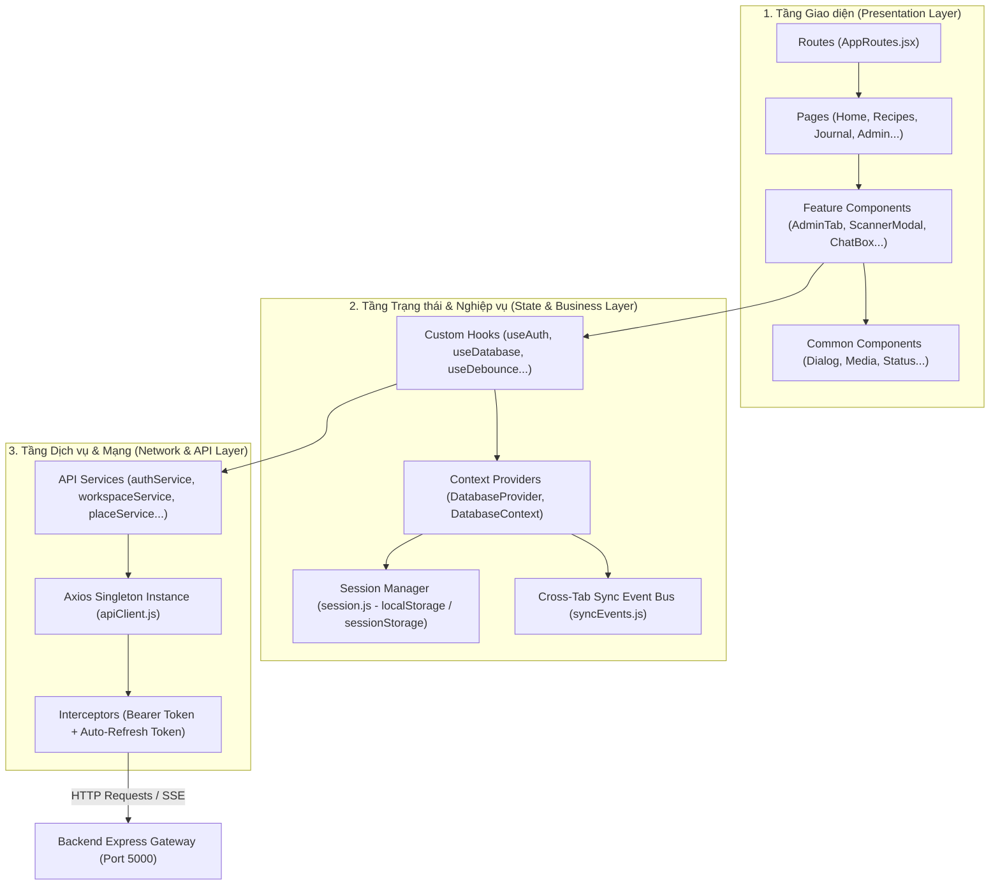

# 🎨 Tài Liệu Kỹ Thuật Phân Hệ Frontend (Client) - Chay Xanh

> **Dự án:** SWP391 - Vegetarian & Healthy Platform (Chay Xanh)  
> **Công nghệ nền tảng:** React 19 + Vite 8 + React-Bootstrap 2 + React Router 8 + Axios + Zod  
> **Điều hướng liên kết:** [Tổng quan dự án](../README.md) | [Tài liệu Backend](../server/README.md) | [Tài liệu AI Service](../ai_service/README.md)

---

## 📑 Mục lục (Table of Contents)

1. [Tổng quan phân hệ Frontend (Frontend Overview)](#1-tổng-quan-phân-hệ-frontend-frontend-overview)
2. [Ngăn xếp công nghệ thực tế (Technology Stack)](#2-ngăn-xếp-công-nghệ-thực-tế-technology-stack)
3. [Kiến trúc tổng thể Frontend (Frontend Architecture)](#3-kiến-trúc-tổng-thể-frontend-frontend-architecture)
4. [Cấu trúc thư mục chi tiết (Project Structure)](#4-cấu-trúc-thư-mục-chi-tiết-project-structure)
5. [Kiến trúc Component & Quy chuẩn phân rã](#5-kiến-trúc-component--quy-chuẩn-phân-rã)
6. [Định tuyến & Điều hướng (Routing & Navigation)](#6-định-tuyến--điều-hướng-routing--navigation)
7. [Quản lý trạng thái ứng dụng (State Management)](#7-quản-lý-trạng-thái-ứng-dụng-state-management)
8. [Tích hợp API & Xử lý lỗi (API Integration)](#8-tích-hợp-api--xử-lý-lỗi-api-integration)
9. [Xác thực & Phân quyền phía Client (Auth & RBAC Flow)](#9-xác-thực--phân-quyền-phía-client-auth--rbac-flow)
10. [Kiểm thực biểu mẫu (Form Validation với Hook Form + Zod)](#10-kiểm-thực-biểu-mẫu-form-validation-với-hook-form--zod)
11. [Giao diện & Thiết kế Responsive (UI Components & Styling)](#11-giao-diện--thiết-kế-responsive-ui-components--styling)
12. [Biến môi trường Frontend (Environment Variables)](#12-biến-môi-trường-frontend-environment-variables)
13. [Hướng dẫn cài đặt & Khởi động (Installation & Setup)](#13-hướng-dẫn-cài-đặt--khởi-động-installation--setup)
14. [Danh mục lệnh phát triển (Development Commands)](#14-danh-mục-lệnh-phát-triển-development-commands)
15. [Chiến lược kiểm thử giao diện (Testing Strategy)](#15-chiến-lược-kiểm-thử-giao-diện-testing-strategy)
16. [Đóng gói Production (Production Build & Preview)](#16-đóng-gói-production-production-build--preview)
17. [Xử lý sự cố thường gặp (Troubleshooting)](#17-xử-lý-sự-cố-thường-gặp-troubleshooting)

---

## 1. Tổng quan phân hệ Frontend (Frontend Overview)

Phân hệ Frontend của **Chay Xanh** là một ứng dụng web dạng **Single Page Application (SPA)** hiện đại, chịu trách nhiệm tương tác trực tiếp với người dùng cuối và quản trị viên.

### Vai trò chính trong hệ thống:
- Cung cấp giao diện tra cứu công thức món chay, từ điển nguyên liệu, bản đồ định vị quán chay GPS thời gian thực.
- Cung cấp cổng tương tác AI: Hộp thoại tư vấn dinh dưỡng (AI ChatBox), Công cụ quét nhãn bao bì & nhận diện món chay (Food Scanner), Trình lập thực đơn tự động 7 ngày, Trích xuất công thức từ video nấu ăn YouTube tiếng Việt.
- Cổng tương tác mạng xã hội ẩm thực: Đăng bài, đính kèm media, bình chọn (Upvote/Downvote), bình luận thảo luận.
- Cổng quản trị chuyên biệt (`/admin`): Dashboard giám sát số liệu, duyệt bài, kiểm tra sức khỏe hệ thống (System Health), quản lý thành viên, xử lý vi phạm và cấu hình văn bản pháp lý.

### Cách giao tiếp với Backend:
- Toàn bộ giao tiếp đều thông qua HTTP REST API với tiền tố `/api` (được cấu hình proxy trong `vite.config.js` trỏ về `http://127.0.0.1:5000`).
- Sử dụng **Axios singleton instance** với Interceptor tự động gắn JWT Bearer token và cơ chế làm mới token ngầm (Silent Token Refresh).
- Tương tác thời gian thực với AI thông qua Server-Sent Events (SSE) streaming.

---

## 2. Ngăn xếp công nghệ thực tế (Technology Stack)

Đối chiếu trực tiếp từ `client/package.json` và `client/package-lock.json`:

| Công nghệ / Thư viện | Phiên bản | Mục đích sử dụng |
| :--- | :--- | :--- |
| **React** | `^19.2.8` (19.3.0) | Thư viện UI nền tảng phát triển SPA theo tư duy component hóa. |
| **Vite** | `^8.3.0` (8.3.3) | Công cụ build bundle và máy chủ phát triển (Dev server) tốc độ cao. |
| **React-Bootstrap** | `^2.10.10` | Bộ thư viện React UI Components xây dựng trên nền Bootstrap 5. |
| **Bootstrap** | `^5.3.8` | Hệ thống CSS framework và Responsive Grid. |
| **Bootstrap Icons** | `^1.13.1` | Thư viện biểu tượng giao diện chính thức. |
| **React Router** | `^8.4.0` | Thư viện định tuyến phía client, hỗ trợ lazy-loading code splitting. |
| **Axios** | `^1.20.0` | HTTP Client xử lý gọi API với interceptor, timeout và token management. |
| **React Hook Form** | `^7.90.0` | Quản lý trạng thái form tối ưu re-render. |
| **Zod** | `^4.6.7` | Định nghĩa schema và validate dữ liệu form an toàn (Type-safe). |
| **@hookform/resolvers**| `^5.9.2` | Tích hợp Zod Schema làm resolver cho React Hook Form. |
| **Leaflet** | `^1.9.4` | Thư viện bản đồ tương tác phục vụ tìm kiếm quán chay theo bán kính. |
| **React Markdown / Remark GFM** | `^10.1.0` / `^4.0.1` | Render định dạng Markdown cho nội dung bài viết và phản hồi AI. |
| **Vitest** | `5.0.3` | Test runner thực thi kiểm thử UI component. |
| **Testing Library** | `@testing-library/react` 16.3.3 | Kiểm thử tương tác component theo hành vi người dùng. |
| **ESLint** | `^10.10.0` | Bộ kiểm tra chất lượng mã nguồn và quy chuẩn React Hooks. |

---

## 3. Kiến trúc tổng thể Frontend (Frontend Architecture)

Frontend được tổ chức theo mô hình **Feature-Driven Architecture** kết hợp phân tầng trách nhiệm rõ ràng (Layered Separation):



---

## 4. Cấu trúc thư mục chi tiết (Project Structure)

```text
client/
├── public/                     # Tài nguyên tĩnh công khai (favicon, manifest)
├── src/
│   ├── assets/                 # Hình ảnh tĩnh và file style SCSS/CSS toàn cục
│   │   ├── images/             # Ảnh minh họa danh mục, logo, placeholder
│   │   └── styles/             # Stylesheet toàn cục (theme, custom animations)
│   │
│   ├── components/             # Các component dùng chung toàn ứng dụng
│   │   ├── common/             # ErrorBoundary, ImageUpload, MediaRenderer, ConfirmDialog...
│   │   └── layout/             # SiteLayout, Header, Footer, Navigation
│   │
│   ├── constants/              # Hằng số định nghĩa phân loại chế độ ăn, nhãn quán, API URL
│   │
│   ├── context/                # Quản lý State toàn cục
│   │   ├── databaseContext.js  # React Context khai báo state
│   │   └── DatabaseProvider.jsx # Provider cung cấp catalog, thông tin user, reload, refreshUser
│   │
│   ├── features/               # Gom nhóm component, hooks và utils theo từng miền nghiệp vụ
│   │   ├── admin/              # Bảng điều khiển quản trị, các tab và modal chức năng
│   │   ├── aiHistory/          # Component hiển thị lịch sử gọi AI cá nhân
│   │   ├── auth/               # Biểu mẫu đăng nhập, đăng ký, khôi phục mật khẩu (AuthForm)
│   │   ├── chat/               # Giao diện hộp thoại AI Chatbot & streaming tin nhắn
│   │   ├── community/          # Quản lý bài đăng cộng đồng, video, bình luận, vote
│   │   ├── diet/               # Chọn mục tiêu ăn chay cá nhân
│   │   ├── foodScanner/        # Giao diện tải ảnh quét nhãn & kiểm tra món chay qua AI
│   │   ├── foodSwap/           # Gợi ý đổi món chay thông minh
│   │   ├── home/               # Các khối nội dung trên trang chủ (Hero, Banners)
│   │   ├── ingredients/        # Tra cứu từ điển nguyên liệu và chi tiết dinh dưỡng
│   │   ├── journal/            # Nhật ký dinh dưỡng, biểu đồ calo và lịch theo dõi cân nặng
│   │   ├── legal/              # Khối hiển thị điều khoản và chính sách bảo mật
│   │   ├── mealPlan/           # Giao diện lập và xem thực đơn AI 7 ngày
│   │   ├── profile/            # Cập nhật thông tin thể trạng, chỉ số BMI, dị ứng
│   │   ├── restaurants/        # Bản đồ Radar quán chay Leaflet, bộ lọc khoảng cách
│   │   └── videoRecipeSummary/ # Giao diện dán link YouTube và theo dõi tiến độ trích xuất
│   │
│   ├── hooks/                  # Custom hooks dùng chung (useDatabase, useDebounce...)
│   │
│   ├── pages/                  # Các trang theo Route
│   │   ├── admin/              # AdminPortal.jsx, AdminAi.jsx
│   │   ├── auth/               # Login.jsx, Register.jsx, ForgotPassword.jsx, ResetPassword.jsx
│   │   ├── Community.jsx       # Trang cộng đồng
│   │   ├── FoodScanner.jsx     # Trang kiểm tra món & quét nhãn
│   │   ├── FoodSwap.jsx        # Trang đổi món chay
│   │   ├── Home.jsx            # Trang chủ
│   │   ├── IngredientDictionary.jsx # Trang từ điển nguyên liệu
│   │   ├── Journal.jsx         # Trang nhật ký dinh dưỡng
│   │   ├── LegalDocument.jsx   # Trang điều khoản & chính sách
│   │   ├── Profile.jsx         # Trang hồ sơ cá nhân
│   │   ├── Recipes.jsx         # Trang khám phá món chay
│   │   └── Restaurants.jsx     # Trang bản đồ quán chay
│   │
│   ├── routes/                 # Cấu hình định tuyến
│   │   ├── AppRoutes.jsx       # Cấu hình BrowserRouter, Routes, Route, lazy-loading
│   │   └── RouteAccessibility.jsx # Tiện ích cập nhật tiêu đề trang và focus accessibility
│   │
│   ├── services/               # Tầng giao tiếp mạng (API Services)
│   │   ├── apiClient.js        # Axios instance trung tâm cấu hình interceptor
│   │   ├── adminService.js     # Gọi API thống kê, quản lý thành viên, kiểm duyệt
│   │   ├── aiApi.js            # Gọi streaming AI Chat, Meal Planner, Quota
│   │   ├── aiGenerationApi.js  # Lấy lịch sử gọi AI
│   │   ├── authService.js      # Gọi đăng nhập, đăng ký, làm mới token, cập nhật hồ sơ
│   │   ├── communityService.js # Gọi bài viết, bình luận, bình chọn
│   │   ├── foodScannerService.js # Tải ảnh quét món ăn qua AI
│   │   ├── ingredientLookupService.js # Tra cứu chi tiết nguyên liệu
│   │   ├── legalDocumentService.js # Lấy văn bản pháp lý công bố
│   │   ├── notificationService.js # Lấy và đánh dấu thông báo đã đọc
│   │   ├── placeService.js     # Tìm quán chay theo GPS và từ khóa
│   │   ├── videoRecipeSummaryApi.js # Tạo và theo dõi job trích xuất video YouTube
│   │   └── workspaceService.js # Lấy catalog, nhật ký, thực đơn, đề xuất quán
│   │
│   ├── utils/                  # Hàm tiện ích dùng chung
│   │   ├── session.js          # Quản lý lưu trữ phiên đăng nhập và token snapshot
│   │   ├── syncEvents.js       # Đồng bộ hóa sự kiện giữa các component và tab trình duyệt
│   │   ├── vietnameseUtils.js  # Xử lý tiếng Việt không dấu phục vụ tìm kiếm
│   │   └── formatters.js       # Format tiền tệ VNĐ, calo, ngày giờ UTC sang múi giờ địa phương
│   │
│   ├── App.jsx                 # Component gốc chứa ErrorBoundary và AppRoutes
│   └── main.jsx                # Entry point gắn kết React DOM, Providers và import CSS
│
├── test/                       # Bộ kiểm thử tự động frontend (50+ file test)
├── index.html                  # File HTML gốc của ứng dụng
├── vite.config.js              # Cấu hình build Vite và proxy chuyển tiếp `/api`
└── eslint.config.js            # Cấu hình linter ESLint 10
```

---

## 5. Kiến trúc Component & Quy chuẩn phân rã

Để đảm bảo khả năng bảo trì và hiệu năng render:

- **Nguyên tắc trách nhiệm đơn lẻ (Single Responsibility Principle):** Mỗi file component chỉ đảm nhận một nhiệm vụ duy nhất và xuất một default export (`PascalCase.jsx`).
- **Giới hạn kích thước mã nguồn:** Bắt buộc không để bất kỳ file component nào vượt quá **200–250 dòng code**. Các logic tính toán phức tạp phải được tách ra custom hook; các khối giao diện lặp lại phải được phân rã thành sub-components trong thư mục `components/` của từng feature.
- **Quy chuẩn 4 trạng thái giao diện (Bắt buộc):** Mọi khu vực tải dữ liệu bất đồng bộ từ API đều phải thể hiện rõ ràng 4 trạng thái:
  1. `loading`: Hiển thị `Spinner` của React-Bootstrap hoặc khung xương Skeleton.
  2. `error`: Hiển thị thông báo lỗi thân thiện (`Alert variant="danger"`), sử dụng thông điệp từ API, không in object lỗi thô.
  3. `empty`: Khi dữ liệu trả về mảng rỗng (`data.length === 0`), hiển thị giao diện trạng thái trống có hướng dẫn hành động tiếp theo.
  4. `success`: Hiển thị dữ liệu thực tế nhận được từ máy chủ.
- **Cấm hard-code dữ liệu giả:** Tuyệt đối không để dữ liệu mẫu ("Lorem ipsum", "Nguyễn Văn A", mảng giả lập) trong code giao diện chính. Nếu thiếu dữ liệu, phải hiển thị empty state chuẩn.

---

## 6. Định tuyến & Điều hướng (Routing & Navigation)

Được cấu hình tập trung tại `src/routes/AppRoutes.jsx` bằng **React Router 8**:

### Danh mục Tuyến đường (Routes):

| Đường dẫn (URL) | Component trang | Trạng thái quyền hạn | Mô tả |
| :--- | :--- | :---: | :--- |
| `/` | `Home.jsx` | Public | Trang chủ giới thiệu nền tảng và chế độ ăn. |
| `/cong-thuc` | `Recipes.jsx` | Public | Khám phá và lọc công thức món ăn chay. |
| `/tu-dien-chay` | `IngredientDictionary.jsx`| Public | Tra cứu giá trị dinh dưỡng của các nguyên liệu. |
| `/quan-chay` | `Restaurants.jsx` | Public | Bản đồ tương tác tìm kiếm quán ăn chay theo vị trí. |
| `/kiem-tra-mon` | `FoodScanner.jsx` | Public / Member | Quét nhãn và phân tích món ăn qua AI Vision. |
| `/doi-mon-chay` | `FoodSwap.jsx` | Public / Member | Gợi ý đổi món chay tương đương dinh dưỡng. |
| `/cong-dong` | `Community.jsx` | Public / Member | Mạng xã hội chia sẻ công thức, bình chọn bài viết. |
| `/dieu-khoan` | `LegalDocument.jsx` | Public | Điều khoản sử dụng dịch vụ đã công bố. |
| `/chinh-sach-bao-mat`| `LegalDocument.jsx` | Public | Chính sách bảo mật thông tin đã công bố. |
| `/dang-nhap` | `Login.jsx` | Guest only | Đăng nhập tài khoản thành viên. |
| `/dang-ky` | `Register.jsx` | Guest only | Đăng ký tài khoản thành viên mới. |
| `/quen-mat-khau`| `ForgotPassword.jsx` | Guest only | Nhập email nhận link khôi phục mật khẩu. |
| `/dat-lai-mat-khau`| `ResetPassword.jsx` | Guest only | Đặt mật khẩu mới qua token trên URL fragment (`#token=...`). |
| `/nhat-ky` | `Journal.jsx` | Member required | Ghi chép nhật ký dinh dưỡng và thực đơn cá nhân. |
| `/ho-so` | `Profile.jsx` | Member required | Xem và chỉnh sửa hồ sơ thể trạng, dị ứng. |
| `/admin` | `AdminPortal.jsx` | Admin only (`role === 1`)| Trung tâm Quản trị toàn diện hệ thống. |
| `/admin/ai` | `AdminAi.jsx` | Admin only (`role === 1`)| Giám sát và can thiệp mô hình AI. |

### Tối ưu hóa hiệu năng:
- Áp dụng `React.lazy()` và `<Suspense>` cho toàn bộ các trang, giúp trình duyệt chỉ tải bundle tương ứng khi người dùng truy cập trang đó (Code Splitting).
- Component `RouteAccessibility` tự động cuộn lên đầu trang, cập nhật `document.title` tương ứng và hỗ trợ trình đọc màn hình.

---

## 7. Quản lý trạng thái ứng dụng (State Management)

Hệ thống kết hợp nhiều tầng quản lý trạng thái phù hợp với từng phạm vi:

### 1. State toàn cục (Global Catalog & User Context):
- Khai báo tại `src/context/DatabaseProvider.jsx` bọc quanh toàn bộ ứng dụng.
- Cung cấp:
  - `data`: Danh mục hệ thống chuẩn (Catalog gồm danh sách nguyên liệu, nhóm thực phẩm, chế độ ăn).
  - `user`: Thông tin hồ sơ của tài khoản đang đăng nhập.
  - `reload()`: Hàm nạp lại catalog khi có cập nhật mới.
  - `refreshUser()`: Hàm đồng bộ lại dữ liệu hồ sơ mới nhất từ Backend (`GET /api/auth/me`).

### 2. Quản lý phiên làm việc & Token (`src/utils/session.js`):
- Hỗ trợ tính năng **"Ghi nhớ đăng nhập" (Remember Me)**:
  - Nếu chọn Ghi nhớ: Lưu trữ token và thông tin phiên vào `localStorage` (tồn tại lâu dài).
  - Nếu không chọn: Lưu trữ vào `sessionStorage` (tự động xóa khi đóng tab).
  - Fallback an toàn vào biến bộ nhớ `memorySession` nếu trình duyệt chặn Web Storage.
- Quản lý phiên bản dữ liệu thông qua `revision` và `identityRevision`. Khi phiên làm việc thay đổi ở một tab khác, sự kiện `chayxanh-session` sẽ kích hoạt cập nhật đồng bộ.

### 3. Đồng bộ hóa sự kiện giữa các thành phần (`src/utils/syncEvents.js`):
- Cơ chế Pub/Sub nội bộ nhẹ nhàng cho phép các component phản ứng với thay đổi mà không cần re-render toàn bộ cây DOM (ví dụ: phát sự kiện `USER_CHANGED` khi người dùng cập nhật cân nặng để các widget tự làm mới).

---

## 8. Tích hợp API & Xử lý lỗi (API Integration)

Triển khai duy nhất tại `src/services/apiClient.js`:

### 1. Cấu hình cơ bản:
```javascript
const apiClient = axios.create({
  baseURL: '/api',
  timeout: 15000,
  withCredentials: true, // Cho phép trình duyệt gửi kèm httpOnly cookie chứa Refresh Token
  headers: { 'Content-Type': 'application/json' },
});
```

### 2. Request Interceptor:
- Tự động lấy snapshot phiên hiện tại từ `session.js`.
- Nếu có Access Token, tự động đính kèm header: `Authorization: Bearer <token>`.
- Gắn kèm `sessionSnapshot` vào cấu hình request để phục vụ đối chiếu khi có lỗi xác thực.

### 3. Response Interceptor & Silent Refresh Token:
- Khi request gặp mã lỗi `401 Unauthorized` và request đó chưa từng thử lại (`!config.authRetried`):
  1. Tạm dừng request hiện tại.
  2. Kích hoạt hàm `refreshSession(snapshot)` gọi `POST /api/auth/refresh`.
  3. Cơ chế **Concurrency Lock (`refreshFlight`)** đảm bảo dù có 10 request cùng nhận 401 thì chỉ có duy nhất **1 request refresh token** được gửi đi máy chủ.
  4. Sau khi nhận Access Token mới, cập nhật vào phiên và tự động gọi lại các request đang chờ (`apiClient.request({ ...config, authRetried: true })`).
  5. Nếu làm mới thất bại (Refresh Token hết hạn hoặc tài khoản bị khóa), xóa phiên đăng nhập (`setSession(null)`) và yêu cầu người dùng đăng nhập lại.

### 4. Chuẩn hóa lỗi API (`normalizeApiError`):
Mọi lỗi trả về từ máy chủ được chuyển đổi thành một đối tượng JavaScript `Error` có cấu trúc:
```javascript
{
  message: "Thông điệp lỗi chi tiết từ máy chủ...",
  status: 400,
  code: "INVALID_INPUT",
  errorCode: "INVALID_INPUT",
  requestId: "req_xxxxxxxxxxxx",
  details: [ { field: "email", message: "Email không hợp lệ" } ]
}
```

---

## 9. Xác thực & Phân quyền phía Client (Auth & RBAC Flow)

### 1. Luồng Đăng nhập (Login):
1. Người dùng nhập email, mật khẩu và tùy chọn ghi nhớ vào `AuthForm`.
2. Form validate dữ liệu bằng `loginSchema`.
3. Gửi yêu cầu qua `authService.login()`.
4. Nhận Access Token và hồ sơ người dùng.
5. Lưu phiên bằng `setSession({ token, user }, { remember })`.
6. Điều hướng người dùng: Nếu là Admin (`role === 1`) chuyển đến `/admin`, nếu là thành viên thông thường chuyển về trang trước đó hoặc `/`.

### 2. Luồng Khôi phục Mật khẩu (Password Recovery):
1. Tại `/quen-mat-khau`, người dùng gửi email qua `PasswordRecoveryForm`. Backend gửi email chứa link dạng `http://localhost:5173/dat-lai-mat-khau#token=<token_64_hex>`.
2. Token được đặt trong **URL fragment (`#`)**, tuyệt đối không truyền qua query parameter để tránh bị rò rỉ vào access log của máy chủ web.
3. Trang `ResetPassword.jsx` trích xuất token từ fragment qua hàm `getPasswordResetToken(window.location.hash)`.
4. Người dùng nhập mật khẩu mới và gửi yêu cầu đổi mật khẩu. Sau khi thành công, điều hướng về trang đăng nhập.

### 3. Phân quyền Cổng Quản trị (`/admin`):
- `AdminPortal.jsx` chủ động đọc `user.role` từ `useDatabase()`.
- Nếu chưa đăng nhập hoặc `user.role !== 1`, hiển thị màn hình từ chối quyền truy cập **"Khu vực Giới hạn Quyền Hạn"** kèm nút quay về trang Đăng nhập.

---

## 10. Kiểm thực biểu mẫu (Form Validation với Hook Form + Zod)

Toàn bộ quy tắc kiểm thực được tập trung tại `src/features/auth/utils/authValidation.js`:

```javascript
// Ví dụ các Schema Zod kiểm thực chặt chẽ:
export const loginSchema = z.object({
  email: z.string().trim().email('Vui lòng nhập email hợp lệ.').max(255),
  password: z.string().min(1, 'Vui lòng nhập mật khẩu.').max(128),
  remember: z.boolean(),
});

export const registrationSchema = z.object({
  email: z.string().trim().email('Vui lòng nhập email hợp lệ.').max(255),
  password: z.string().min(8, 'Mật khẩu phải có ít nhất 8 ký tự.').max(128)
    .refine((v) => new TextEncoder().encode(v).length <= 72, 'Mật khẩu không được vượt quá 72 byte UTF-8.'),
  full_name: z.string().trim().min(1, 'Vui lòng nhập họ và tên.').max(255),
  agreement: z.literal(true, { error: 'Vui lòng đồng ý với điều khoản và chính sách bảo mật.' }),
});
```
- Sử dụng `@hookform/resolvers/zod` để tích hợp schema vào hook `useForm({ resolver: zodResolver(...) })`.
- Mọi trường nhập liệu đều hiển thị lỗi kiểm thực trực tiếp ngay dưới ô input (`Form.Control.Feedback type="invalid"`).

---

## 11. Giao diện & Thiết kế Responsive (UI Components & Styling)

- **Chuẩn hóa React-Bootstrap:** Sử dụng toàn diện các thẻ `Container`, `Row`, `Col`, `Card`, `Button`, `Modal`, `Alert`, `Spinner`. Hạn chế tối đa việc viết class HTML Bootstrap rời rạc.
- **Hệ thống Grid Responsive (Mobile-First):**
  - Màn hình điện thoại (`xs`): Hiển thị 1 cột, menu thu gọn (Offcanvas/Navbar collapse).
  - Màn hình máy tính bảng (`md`): Hiển thị lưới 2 cột.
  - Màn hình máy tính để bàn (`lg`, `xl`): Hiển thị lưới 3–4 cột cân đối.
- **Tối ưu trải nghiệm (UX):**
  - Trạng thái nút bấm luôn tự động hiển thị `Spinner` nhỏ và bị `disabled` khi form đang gửi yêu cầu (`isSubmitting === true`).
  - Toàn bộ ảnh sản phẩm, quán ăn đều có ảnh giữ chỗ (fallback placeholder) khi ảnh nguồn bị lỗi hoặc đang tải.

---

## 12. Biến môi trường Frontend (Environment Variables)

File mẫu cấu hình nằm tại `client/.env.example`.

| Tên biến | Bắt buộc | Giá trị mặc định | Giải thích chi tiết |
| :--- | :---: | :--- | :--- |
| `VITE_API_URL` | Không | `/api` | Base path cho các kết nối fetch/SSE tới AI. Axios instance sử dụng `/api` cố định. Khi chạy local, giữ nguyên `/api` để Vite tự động proxy sang cổng 5000, đảm bảo chung domain và hoạt động của httpOnly cookie. |

> **Cảnh báo bảo mật:** Tuyệt đối không khai báo khóa bí mật (JWT Secret, API Key của LLM, Mật khẩu cơ sở dữ liệu) trong các biến môi trường có tiền tố `VITE_*` vì các biến này sẽ bị phơi bày hoàn toàn trên trình duyệt người dùng sau khi đóng gói.

---

## 13. Hướng dẫn cài đặt & Khởi động (Installation & Setup)

### Bước 1: Di chuyển vào thư mục Frontend
```powershell
cd client
```

### Bước 2: Cài đặt dependencies
Cài đặt chính xác các phiên bản đã được khóa trong `package-lock.json`:
```powershell
npm ci --include=optional
```

### Bước 3: Khởi tạo file cấu hình môi trường
```powershell
if (!(Test-Path .env)) { Copy-Item .env.example .env }
```

### Bước 4: Khởi chạy máy chủ phát triển
```powershell
npm run dev
```
> Trình duyệt truy cập tại: `http://localhost:5173`. Các request tới `/api` và `/uploads` sẽ được tự động chuyển tiếp tới Backend tại cổng 5000.

---

## 14. Danh mục lệnh phát triển (Development Commands)

| Lệnh thực thi | Mục đích |
| :--- | :--- |
| `npm run dev` | Khởi động Vite dev server với Hot Module Replacement tại cổng 5173. |
| `npm run build` | Đóng gói mã nguồn production tối ưu vào thư mục `dist/`. |
| `npm run preview` | Khởi chạy máy chủ local xem thử ứng dụng sau khi đã build production. |
| `npm run lint` | Chạy kiểm tra lỗi cú pháp và cảnh báo code với ESLint. |
| `npm test` | Chạy bộ kiểm thử logic bằng Node.js Native Test Runner (`test/*.test.js`). |
| `npm run test:ui` | Chạy toàn bộ kiểm thử thành phần giao diện người dùng với Vitest. |
| `npm run test:video-recipes` | Chạy kiểm thử riêng cho tính năng trích xuất công thức video. |

---

## 15. Chiến lược kiểm thử giao diện (Testing Strategy)

Phân hệ Frontend bao gồm hai bộ kiểm thử chuyên biệt:

### 1. Kiểm thử Logic & Tiện ích (`npm test`):
- Sử dụng Node.js Native Test Runner kiểm tra logic phiên làm việc (`session.test.js`), kiểm thực dữ liệu form, hàm phân tích thành phần nhãn, thuật toán tính calo và tiện ích xử lý tiếng Việt không dấu.

### 2. Kiểm thử Tương tác Giao diện (`npm run test:ui`):
- Sử dụng **Vitest** kết hợp **React Testing Library** và `jsdom`.
- Bao phủ:
  - Hành vi submit form đăng nhập, đăng ký và hiển thị lỗi validate.
  - Phản ứng của giao diện khi nhận các mã trạng thái HTTP khác nhau (401, 403, 500).
  - Thao tác chuyển tab trong Admin Portal.
  - Hoạt động của hộp thoại Chat và hiển thị kết quả từ Food Scanner.

---

## 16. Đóng gói Production (Production Build & Preview)

Để chuẩn bị đóng gói sản phẩm phục vụ môi trường thực tế:

```powershell
# Thực hiện đóng gói
npm run build
```
- Vite sẽ biên dịch JSX, nén CSS/JS và lưu trữ toàn bộ tài sản tại thư mục `dist/`.
- Kiểm tra bản đóng gói bằng lệnh:
```powershell
npm run preview
```

---

## 17. Xử lý sự cố thường gặp (Troubleshooting)

1. **Lỗi `ReferenceError: window is not defined` hoặc `sessionStorage is not defined`:**
   - *Nguyên nhân:* Xảy ra khi chạy test trong môi trường Node.js thuần không có DOM.
   - *Khắc phục:* Đảm bảo file test import mock global browser hoặc chạy qua bộ test UI `npm run test:ui` (nơi Vitest đã kích hoạt môi trường `jsdom`).
2. **Cảnh báo `react-hooks/exhaustive-deps` tại `RestaurantMap.jsx`:**
   - *Nguyên nhân:* Effect khởi tạo bản đồ Leaflet có dependency rỗng `[]` để tránh việc tạo lại bản đồ mỗi khi vị trí người dùng cập nhật nhẹ.
   - *Khắc phục:* Đây là chủ ý thiết kế hiệu năng, không phải lỗi biên dịch. Không tự ý thêm đối tượng `userLocation` vào dependency list.
3. **Cảnh báo `Some chunks are larger than 500 kB after minification`:**
   - *Nguyên nhân:* Bundle chính chứa các thư viện lớn như Bootstrap và Leaflet.
   - *Khắc phục:* Ứng dụng đã áp dụng `React.lazy()` tại tầng route. Cảnh báo này không làm gián đoạn quá trình build.
4. **Không kết nối được API Backend (Lỗi `Network Error` hoặc `404`):**
   - *Nguyên nhân:* Backend Server tại cổng 5000 chưa được khởi động.
   - *Khắc phục:* Hãy chắc chắn rằng bạn đã khởi động Backend (`cd server; npm run dev`) trước khi thao tác trên giao diện Frontend.
