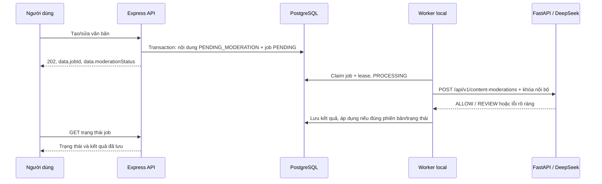

# Kiểm duyệt nội dung cộng đồng

Tính năng kiểm tra **văn bản bài blog và bình luận** bằng DeepSeek qua AI Service. Express lưu nội dung và job trong cùng transaction; worker local gọi AI qua HTTP ngoài transaction. AI không đọc PostgreSQL. Không thêm Redis, dịch vụ hàng đợi hay công cụ triển khai.

## Chính sách đã chốt

| Nội dung | Hướng xử lý |
| --- | --- |
| Sườn chay/thịt chay từ nấm, đậu nành; nấm đùi gà | Cho phép khi văn bản nêu rõ là chay/nguyên liệu thực vật |
| Món chay có trứng/sữa/mật ong | Cho phép theo chính sách cộng đồng, không áp chế độ thuần chay cá nhân |
| Chia sẻ chuyển từ món thịt sang món chay; phủ định “không dùng thịt/cá” | Cho phép khi ngữ cảnh rõ ràng |
| Nhắc tới món/thực phẩm từ thịt, cá, hải sản, kể cả chỉ có tên món (“Cá kho tộ”, “Gà rán”, “Sườn kho”, “thịt bò”) | Đề nghị Admin xem xét |
| Spam, lừa đảo, công kích; mô tả chay mâu thuẫn với thành phần động vật | Đề nghị Admin xem xét khi có dấu hiệu trong nội dung |
| Phân vân, ngữ cảnh không rõ ràng | Đề nghị Admin xem xét (`REVIEW` chỉ tạm ẩn, không xóa hay phạt) |

Chính sách hiện tại: `vegetarian-community-v2`.

`REVIEW` yêu cầu lý do, ít nhất một phân loại và bằng chứng trích nguyên văn từ tiêu đề/nội dung. `ALLOW` không mang phân loại/bằng chứng vi phạm. Cả AI và BE kiểm tra cấu trúc kết quả; BE kiểm tra lại bằng chứng trước khi cập nhật DB. Đây là biện pháp giảm kết quả sai, không bảo đảm mô hình phân loại đúng mọi trường hợp. Admin có quyết định cuối cùng.

## Khởi chạy local

1. Cài dependencies theo [README gốc](../README.md). Tạo `server/.env`, `ai_service/.env` từ các file `.env.example`; không ghi đè file đã cấu hình. Điền cùng `INTERNAL_API_KEY` cho BE và AI, đặt `DEEPSEEK_API_KEY` hợp lệ ở AI.
2. Từ `server/`, chạy `npm run prisma:generate` và `npx prisma migrate deploy`. Lệnh migrate giữ dữ liệu hiện có, chỉ áp dụng migration còn thiếu. Với DB mới/được phép xóa dữ liệu, `npm run seed` tự migrate rồi seed; **không seed DB cần giữ dữ liệu**.
3. Từ `ai_service/`, chạy `uvicorn main:app --host 127.0.0.1 --port 8000 --reload` trong môi trường Python đã cài requirements. `GET /health` kiểm tra tiến trình; không chứng minh provider kiểm duyệt gọi thành công.
4. Đặt `CONTENT_MODERATION_ENABLED=true` trong `server/.env`, rồi khởi động lại API bằng `npm run dev`. Giữ `AI_SERVICE_URL=http://127.0.0.1:8000`. Worker kiểm duyệt tự chạy cùng tiến trình API (log `Content moderation worker started`).
5. (Tùy chọn) Chạy thêm worker độc lập bằng `npm run worker:content-moderation` tại `server/` khi cần tăng thông lượng; các worker nhận job bằng `FOR UPDATE SKIP LOCKED` nên không xử lý trùng.
6. Từ `client/`, chạy `npm run dev`, truy cập `http://localhost:5173`. Người đăng xem “Bài viết của tôi”; Admin mở “Kiểm duyệt AI”.

Các bước trên là hướng dẫn bật tính năng; việc cập nhật tài liệu không tự sửa `.env` thật hoặc bật worker trên máy khác.

| Biến | Service | Mặc định | Ý nghĩa |
| --- | --- | --- | --- |
| `CONTENT_MODERATION_ENABLED` | BE/API và worker | `false` | Bật tạo/xử lý job; cần restart cả hai sau khi đổi |
| `CONTENT_MODERATION_TIMEOUT_MS` | Worker | `30000` ms | Deadline toàn bộ HTTP AI, gồm đọc response body; phạm vi 1000–120000 |
| `CONTENT_MODERATION_MAX_ATTEMPTS` | Worker | `3` | Tổng số lần thử mỗi job, gồm lần đầu; phạm vi 1–5 |
| `CONTENT_MODERATION_TIMEOUT_SECONDS` | AI | `20` giây | Deadline inference; phạm vi 1–120. Nên ngắn hơn deadline worker |
| `DEEPSEEK_MODEL` | AI | `deepseek-chat` | Dùng cấu hình/client LLM hiện có; kết quả lưu tên model provider trả về nếu có |
| `INTERNAL_API_KEY` | BE và AI | Không có | 32–256 ký tự ASCII in được, không khoảng trắng; không đưa vào client |

`AI_TIMEOUT_MS` của gateway chatbot/thực đơn không thay thế timeout kiểm duyệt. Worker poll DB mỗi 2 giây; lỗi được phép retry chờ 30 giây. Lease dài hơn deadline HTTP 30 giây để thu hồi công việc nếu worker chết. Shutdown bằng Ctrl+C; job còn dang dở có thể được thử lại sau khi lease hết hạn. Không có cam kết mỗi job chỉ gọi model đúng một lần.

## Luồng và trạng thái



API **trả job ngay**, không đợi đủ 3 giây mới chuyển sang chạy nền. Mốc 3 giây ở giao diện tác giả là chu kỳ polling khi còn job đang chờ. Người dùng có thể chuyển trang/đóng trình duyệt; worker tiếp tục chạy. Sau khi quay lại, giao diện đọc lại trạng thái từ DB. Admin poll hàng chờ mỗi 5 giây khi màn kiểm duyệt đang mở; đây không phải email/push notification.

| Job | Nội dung | Hiển thị công khai |
| --- | --- | --- |
| `PENDING` / `PROCESSING` | `PENDING_MODERATION` | Chưa công khai |
| `COMPLETED`, kết quả `ALLOW`, áp dụng thành công | Blog `PUBLISHED`, bình luận `ACTIVE` | Có, nếu nội dung cha vẫn công khai |
| `COMPLETED`, kết quả `REVIEW`, áp dụng thành công | `HIDDEN_BY_AI`; bình luận có `is_flagged_by_ai=true` | Không; chờ Admin |
| `FAILED` | Giữ `PENDING_MODERATION` | Không; Admin vẫn xử lý được |
| `COMPLETED`, `applied=false` | Đã có phiên bản/quyết định mới | Không suy ra trạng thái hiện tại từ kết quả cũ |

`COMPLETED` chỉ có nghĩa lần kiểm tra đã kết thúc; không đồng nghĩa đã công khai. `applied=true` ghi nhận kết quả từng được áp dụng, không bảo đảm tác giả/Admin chưa đổi trạng thái sau đó. Danh sách tác giả có `isCurrent` và `targetStatus`; Admin chỉ nhận kết quả khớp phiên bản hiện tại. Admin quyết định dựa trên `contentVersion` để modal cũ không ghi đè nội dung vừa sửa/xóa. Gỡ bình luận là xóa mềm bình luận, không gỡ bài cha.

Nội dung đã vào luồng kiểm duyệt (`moderationVersion` >0) bắt buộc gửi đúng `contentVersion` khi Admin quyết định; thiếu hoặc sai trả `409`. Chỉ nội dung cũ ở phiên bản `0` chấp nhận bỏ qua trường này để tương thích, và thao tác DB vẫn so khớp phiên bản `0` đã đọc.

## API

Hợp đồng đầy đủ: [content-moderation-openapi.json](content-moderation-openapi.json). Các endpoint BE đều dùng JWT; endpoint AI dùng khóa nội bộ, không dùng JWT người dùng.

| Endpoint | Quyền | Hành vi |
| --- | --- | --- |
| `POST /api/v1/blogs`, `PUT /api/v1/blogs/{id}` | Tác giả/luồng quyền hiện có | `202` nếu tạo job; receipt ở `data.jobId`, nội dung ở `data.blog` |
| `POST /api/v1/comments`, `PUT /api/v1/comments/{id}` | Tác giả/luồng quyền hiện có | `202` nếu tạo job; nội dung ở `data.comment`; create dùng trường cũ `post_id` |
| `GET /api/v1/content-moderation-jobs?page=1&limit=10` | Đăng nhập | Chỉ job của tài khoản hiện tại, kể cả khi tài khoản là Admin; limit tối đa 100 |
| `GET /api/v1/content-moderation-jobs/{jobId}` | Chủ job hoặc Admin | `data.job`; không trả snapshot đầy đủ hoặc lease |
| `GET /api/v1/admin/moderation/flagged` | Admin, role 1 | Bài/bình luận bị cờ, đang chờ hoặc kiểm tra lỗi; `moderation` có thể null |
| `POST /api/v1/admin/moderation/resolve` | Admin, role 1 | `APPROVE` hoặc `REJECT`; gửi `entityType`, `entityId`, `contentVersion`, `notes` tùy chọn (≤500 ký tự) |
| `POST /api/v1/content-moderations` trên port 8000 | `X-Internal-Api-Key` | Kiểm tra văn bản, không tự ghi DB hoặc đổi quyền hiển thị |

Khi cờ tắt, create giữ `201`/edit `200` như luồng cũ. Sửa nguyên văn không tạo job mới; sửa nội dung đang bị ẩn không tự công khai. Client gửi `status`/`moderationVersion` không được tự cấp quyền công khai.

Danh sách job trả `{success,message,data:{items},meta:{page,limit,total,pending,requestId}}`. `pending` đếm toàn bộ job đang chờ của người dùng, không chỉ trang hiện tại. Preview tối đa 120 ký tự. Kết quả lưu `decision`, `reason`, `categories`, `evidence`, `modelName`, `policyVersion`; không có điểm “độ tin cậy” bịa sẵn.

AI nhận `jobId` UUID, `contentType` POST/COMMENT, `contentVersion` ≥1, `title` tùy chọn (≤255), `content` không trống (≤50000). BE vẫn giới hạn bình luận ≤5000. AI trả `200` có verdict hợp lệ, `401` khi sai/thiếu khóa, `422` khi sai đầu vào, `502` khi output không hợp lệ và `503` khi thiếu provider key/timeout/provider lỗi. Worker không coi lỗi thành `ALLOW`.

## Xử lý sự cố

- Bài/bình luận công khai ngay, không có job: cờ `CONTENT_MODERATION_ENABLED` chưa bật hoặc API chưa restart; nội dung tạo khi cờ tắt không được quét lại tự động.
- Job chờ lâu: kiểm tra log API có `Content moderation worker started`, đúng DB và AI Service đang chạy.
- `MODERATION_AI_AUTH_FAILED`: sửa khóa BE/AI, restart API/AI/worker. Lỗi auth không tự retry; Admin xử lý các job đã `FAILED`.
- `AI_NOT_CONFIGURED`: worker thiếu khóa nội bộ. `MODERATION_AI_UNAVAILABLE`/`MODERATION_AI_TIMEOUT`/`MODERATION_AI_INVALID_OUTPUT`: xem cấu hình AI, provider và deadline; không công khai nội dung chỉ để làm rỗng hàng chờ.
- Hết số lần thử: job `FAILED` vẫn xuất hiện tại Admin. Sau khi sửa nguyên nhân, Admin duyệt/gỡ theo nội dung; không có nút retry job thất bại hoặc sửa SQL thủ công trong luồng hiện tại.
- Admin nhận `409`: nội dung đã thay đổi, đã bị xóa hoặc không còn trong hàng chờ; làm mới rồi xem lại trước khi quyết định.
- Tắt cờ không tự công khai nội dung đang chờ và không xóa job. Admin vẫn có thể xử lý thủ công. Không chạy seed để “sửa” hàng chờ.

## Kiểm thử

Backend nạp `.env.test`, bắt buộc DB `_test` riêng. Tạo `.env.test` từ `.env.test.example` và điền các giá trị thật cho DB test. Chỉ chạy `npm run test:prepare` khi được phép reset **DB test**.

```powershell
# Từ thư mục gốc; dependencies và DB test đã chuẩn bị
Set-Location server
npm run test:content-moderation
npm test
Set-Location ../client
npm test
npm run test:ui
npm run build
Set-Location ../ai_service
.\venv\Scripts\python.exe -m pytest tests -q
.\venv\Scripts\python.exe -m ruff check api/content_moderation.py schemas/content_moderation.py services/content_moderation.py tests/test_content_moderation.py core/config.py main.py
```

Test HTTP tích hợp dùng server AI giả lập **chỉ trong test**, chạy API/worker/Prisma/HTTP thật; test FastAPI thay model ở fixture. Chúng xác nhận hợp đồng và luồng xử lý, không đo độ chính xác phân loại thực phẩm của DeepSeek. Kiểm tra provider thật cần khóa hợp lệ, có thể tính phí và thay đổi theo model; kết quả một số ví dụ không chứng minh độ chính xác tổng thể.

## Phạm vi hiện tại

- Chỉ văn bản blog/bình luận; không tự quét ảnh, video, OCR hoặc nội dung ở liên kết ngoài.
- Seed không bịa cờ AI, không tạo job/kết quả AI sẵn. Nội dung lịch sử chưa được tự quét lại hàng loạt; bật cờ chỉ đưa các lần tạo/sửa văn bản phù hợp vào hàng chờ.
- Chưa thêm cơ chế tự ẩn theo số báo cáo, thông báo kết quả hai chiều, email cho Admin hay cảnh báo tác giả khi bị báo cáo. Bình luận đang chờ không phát tán văn bản qua notification; chưa có bước phát lại notification sau khi worker cho phép.
- Kết quả kiểm duyệt và tên model được lưu trên job. Màn giám sát model/`ai_logs` cũ không phải nguồn thống kê đầy đủ cho các lần worker gọi kiểm duyệt.
- Job/snapshot lưu trong PostgreSQL, chưa có cơ chế dọn lịch sử job tự động riêng; không xóa nội dung hoặc reset DB để giảm số job.
