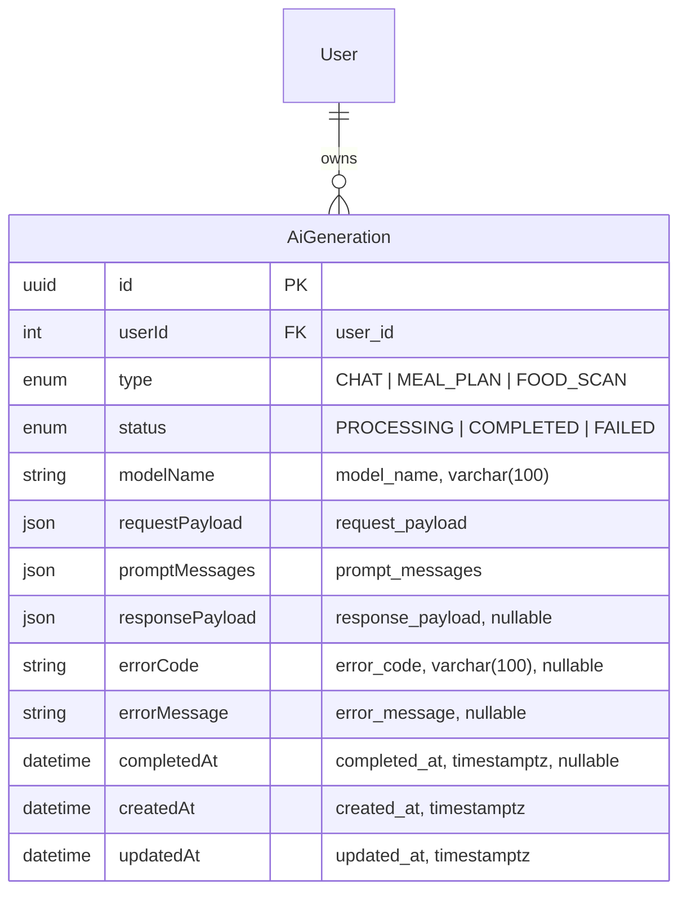
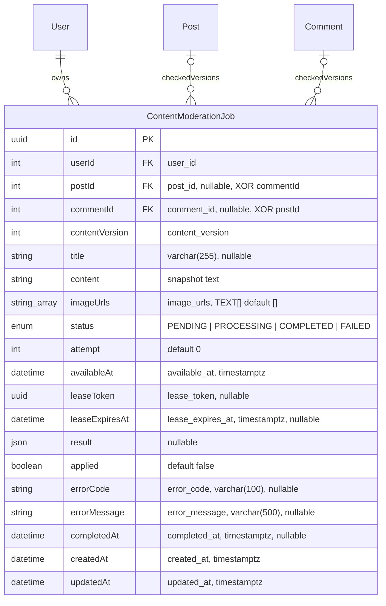
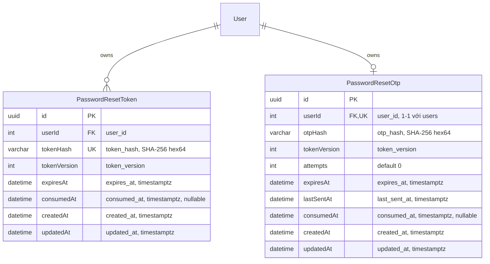
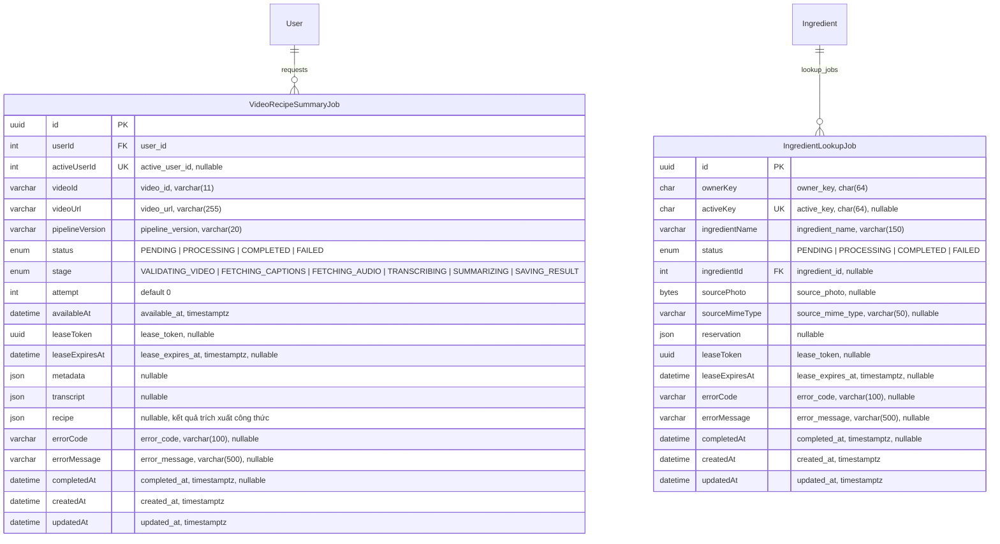

<!-- docs/ERD.md -->
# Sơ đồ Cơ sở Dữ liệu (Entity Relationship Diagram - ERD)

Tài liệu thiết kế cấu trúc Cơ sở dữ liệu cho dự án Healthy Food Community & AI Diet Assistant (SWP391), đồng bộ 100% với định nghĩa Prisma (`server/prisma/schema.prisma`), các migrations hiện có và PostgreSQL database (gồm 35 bảng sau tối ưu hóa). Chi tiết từ điển dữ liệu, giải thích từng thuộc tính và nghiệp vụ xem tại: [DATABASE_SCHEMA.md](DATABASE_SCHEMA.md).

---

## 1. Lịch sử sinh AI (AI Generation History)

`AiGeneration` ánh xạ bảng `ai_generations`; chỉ Backend ghi dữ liệu khi người dùng đăng nhập gọi các tính năng AI.
- `type` gồm 3 loại tác vụ: `CHAT` (tư vấn dinh dưỡng), `MEAL_PLAN` (sinh thực đơn tuần), và `FOOD_SCAN` (nhận diện ảnh món ăn / nguyên liệu).
- `promptMessages` lưu snapshot `{modelName, attempt, messages}`; `responsePayload` giữ toàn bộ kết quả trả về từ AI Service.
- Không lưu lịch sử sinh đối với khách vãng lai (Guest). Chi tiết: [AI_INTEGRATION.md](AI_INTEGRATION.md).

---

## 2. Job kiểm duyệt nội dung (Content Moderation Queue)

`ContentModerationJob` ánh xạ `content_moderation_jobs`; quản lý hàng đợi kiểm duyệt văn bản và hình ảnh của bài viết hoặc bình luận.
- Mỗi job gắn đúng một bài viết (`postId`) hoặc một bình luận (`commentId`) (ràng buộc XOR), duy nhất theo đối tượng và `contentVersion`.
- `imageUrls`: Mảng chuỗi đường dẫn ảnh đính kèm bài viết/bình luận cần AI kiểm duyệt (thêm từ migration `20261107042935_add_moderation_job_image_urls`).
- `Post` và `Comment` có trường `moderationVersion` (cột `moderation_version`, mặc định 0) để theo dõi phiên bản nội dung đã được duyệt.
- Snapshot `content`, lease token và thời hạn `leaseExpiresAt` dùng cho background worker xử lý. Chi tiết: [CONTENT_MODERATION.md](CONTENT_MODERATION.md).

---

## 3. Khôi phục mật khẩu & Quản lý trạng thái xóa tài khoản

Hệ thống hỗ trợ 2 cơ chế đặt lại mật khẩu và cơ chế khôi phục mềm tài khoản:

1. **`PasswordResetToken`** (ánh xạ `password_reset_tokens`): Quản lý token URL 32-byte ngẫu nhiên. Chỉ lưu băm SHA-256 (`tokenHash`). `tokenVersion` so khớp với `User.tokenVersion` (cột `token_version`). Khi đổi mật khẩu, `User.tokenVersion` tăng lên để vô hiệu hóa toàn bộ link cũ.
2. **`PasswordResetOtp`** (ánh xạ `password_reset_otps`): Quản lý mã OTP 6 số gửi qua email (migration `20261107112157_add_password_reset_otps`). Quan hệ 1-1 với `User` qua `userId`. Lưu băm SHA-256 (`otpHash`), giới hạn số lần thử (`attempts`), thời hạn `expiresAt` (5 phút) và mốc gửi lại `lastSentAt` (cooldown 60s).
3. **Trạng thái trước xóa tài khoản**: `Post.statusBeforeAccountDeletion` và `Comment.statusBeforeAccountDeletion` (cột `status_before_account_deletion`, VARCHAR(30) nullable). Khi người dùng xóa tài khoản, trạng thái ban đầu được snapshot lại trước khi chuyển sang `DELETED`. Khi khôi phục tài khoản, nội dung được hoàn nguyên chính xác trạng thái cũ.
4. **Lưu ý kiến trúc bảng `LegalDocument` (`legal_documents`)**: Bảng này từng được thêm ở migration `20261104003257`, nhưng sau đó đã chính thức bị **gỡ bỏ** (`DROP TABLE`) qua migration `20261107074500_remove_legal_documents` do tài liệu điều khoản/chính sách được chuyển sang quản lý dưới dạng static assets.

---

## 4. Tác vụ AI chạy ngầm (Background AI Jobs)

Bao gồm các job xử lý bất đồng bộ kết nối giữa Backend và AI Service:

1. **`VideoRecipeSummaryJob`** (ánh xạ `video_recipe_summary_jobs`): Quản lý hàng đợi xử lý bóc tách công thức nấu ăn từ link video YouTube/TikTok (migration `20261026030123_add_video_recipe_summary_jobs`). Có cơ chế lease lock, phân giai đoạn qua `stage` (`VALIDATING_VIDEO`, `FETCHING_CAPTIONS`, `FETCHING_AUDIO`, `TRANSCRIBING`, `SUMMARIZING`, `SAVING_RESULT`). Kết quả bóc tách công thức dạng JSON được lưu trực tiếp tại cột `recipe` (đã tối ưu gộp bảng `video_recipe_summaries` vào job).
2. **`IngredientLookupJob`** (ánh xạ `ingredient_lookup_jobs`): Background job tự động tra cứu thành phần dinh dưỡng nguyên liệu qua AI khi hệ thống chưa có dữ liệu (migration `20261029041440_add_ingredient_lookup_jobs`).
3. **Lưu ý tối ưu bảng tỷ trọng chất lỏng**: Dữ liệu tỷ trọng (`density`) quy đổi thể tích (ml) và khối lượng (gram) đã được gộp trực tiếp vào bảng `ingredients` (`density FLOAT?`), loại bỏ bảng phụ 1:1 `liquid_ingredient_densities`.

---

## 5. Các bảng nghiệp vụ cốt lõi (Core Business Domain)

Sơ đồ tổng thể toàn bộ 29 thực thể nghiệp vụ cốt lõi (tổng 35 bảng toàn hệ thống), phản ánh chính xác 100% cấu trúc thực tế của PostgreSQL và Prisma schema sau khi tối ưu giảm 6 bảng 1:1 dư thừa.

```mermaid
erDiagram
    %% ==========================================
    %% 1. USER & HEALTH PREFERENCES
    %% ==========================================
    User {
        int user_id PK
        varchar email UK
        varchar password_hash
        int tokenVersion "token_version, default 0"
        varchar full_name
        smallint role "default 2"
        varchar status "default ACTIVE"
        datetime deleted_at "timestamptz, nullable"
        datetime created_at "timestamptz"
    }
    DietType {
        smallint diet_type_id PK
        varchar name
        text description
    }
    HealthProfile {
        int profile_id PK
        int user_id FK,UK "1-1 với User"
        smallint diet_type_id FK "nullable"
        float height
        float weight
        date dob
        varchar gender
        varchar health_goal
        float calorie_goal "nullable"
        varchar goal "nullable"
        float protein_goal "nullable"
        float carbs_goal "nullable"
        float fat_goal "nullable"
        float fiber_goal "nullable"
    }
    HealthHistory {
        int history_id PK
        int user_id FK
        datetime recorded_date "timestamptz"
        float weight
        float bmi
    }
    UserAllergy {
        int user_id PK,FK
        int ingredient_id PK,FK
    }

    %% ==========================================
    %% 2. CONTENT & COMMUNITY
    %% ==========================================
    Category {
        int category_id PK
        varchar name
    }
    Post {
        int post_id PK
        int author_id FK
        varchar post_type
        varchar status "default PUBLISHED"
        varchar statusBeforeAccountDeletion "status_before_account_deletion, nullable"
        int moderationVersion "moderation_version, default 0"
        datetime deleted_at "timestamptz, nullable"
        datetime created_at "timestamptz"
    }
    Video {
        int post_id PK,FK "1-1 với Post"
        varchar title
        varchar video_url
        varchar thumbnail_url
        int duration
        text transcript
    }
    Blog {
        int post_id PK,FK "1-1 với Post"
        varchar title
        text content
        int attached_video_id FK "nullable"
    }
    PostCategory {
        int post_id PK,FK
        int category_id PK,FK
    }
    PostAttachment {
        int attachment_id PK
        int post_id FK
        varchar file_url
        varchar file_type
        varchar file_name
        datetime created_at "timestamptz"
    }
    Comment {
        int comment_id PK
        int post_id FK
        int user_id FK
        text content
        boolean is_flagged_by_ai "default false"
        varchar status "default ACTIVE"
        varchar statusBeforeAccountDeletion "status_before_account_deletion, nullable"
        int moderationVersion "moderation_version, default 0"
        datetime deleted_at "timestamptz, nullable"
        datetime created_at "timestamptz"
    }
    PostVote {
        int user_id PK,FK
        int post_id PK,FK
        varchar vote_type
    }

    %% ==========================================
    %% 3. INGREDIENTS & RECIPES
    %% ==========================================
    Ingredient {
        int ingredient_id PK
        varchar name UK
        float calories_per_100g "default 0"
        float protein "default 0"
        float fat "default 0"
        float carbs "default 0"
        float fiber "fiber, default 0"
        float density "tỷ trọng g/ml, nullable"
    }
    IngredientDetails {
        int ingredient_id PK,FK "1-1 với Ingredient"
        varchar category
        varchar origin
        boolean plant
        text description
        text cooking
        text aliases
        varchar image_url
    }
    IngredientImage {
        int ingredient_id PK,FK "1-1 với Ingredient"
        varchar mime_type
        bytes image_data
        varchar attribution
        varchar source_url
        varchar license
        text license_text
    }
    IngredientAlternative {
        varchar id PK
        varchar chip
        varchar emoji
        varchar original
        varchar role
        json alternatives
        text description
        text keywords
    }
    Recipe {
        int recipe_id PK
        int post_id FK
        int category_id FK
        smallint diet_type_id FK "nullable"
        varchar recipe_name
        text description
        varchar image_url
        int prep_time
        float total_calories
        text instructions
    }
    RecipeIngredient {
        int recipe_id PK,FK
        int ingredient_id PK,FK
        float quantity
        varchar unit
    }

    %% ==========================================
    %% 4. NUTRITION & MEAL PLANNING
    %% ==========================================
    MealPlan {
        int plan_id PK
        int user_id FK
        varchar title
        date start_date
        date end_date
        float target_calories
    }
    MealPlanDetail {
        int plan_detail_id PK
        int plan_id FK
        int recipe_id FK "nullable khi là món AI gợi ý"
        varchar meal_type
        smallint day_of_week
        varchar custom_food_name "tên món AI gợi ý"
        float calories
        float protein
        float carbs
        float fat
    }
    FoodDiary {
        int diary_id PK
        int user_id FK
        date consumed_date
        varchar meal_type
        int recipe_id FK "nullable"
        varchar custom_food_name
        float calories
        varchar serving "nullable"
        float protein "default 0"
        float carbs "default 0"
        float fat "default 0"
        float fiber "default 0"
    }

    %% ==========================================
    %% 5. RESTAURANTS & REVIEWS
    %% ==========================================
    Restaurant {
        int restaurant_id PK
        smallint diet_type_id FK "nullable"
        varchar name
        varchar address
        varchar phone "nullable"
        varchar image_url "nullable"
        float rating "default 4.5"
        decimal latitude "decimal(10, 7), nullable"
        decimal longitude "decimal(10, 7), nullable"
        boolean isIngredientShop "is_ingredient_shop, default false"
        varchar source "default local"
        varchar place_id UK "nullable"
        varchar status "default APPROVED"
        varchar city "nullable"
        varchar hours "nullable"
        varchar price_range "price_range, nullable"
        boolean separate_kitchen "separate_kitchen, nullable"
        datetime created_at "timestamptz"
        datetime updated_at "timestamptz"
    }
    RestaurantReview {
        int review_id PK
        int restaurant_id FK
        int user_id FK
        smallint stars
        text content
        datetime created_at "timestamptz"
    }
    RestaurantRecipe {
        int restaurant_id PK,FK
        int recipe_id PK,FK
        decimal price "decimal(18, 2), nullable"
    }

    %% ==========================================
    %% 6. SYSTEM, REPORTS & QUOTA
    %% ==========================================
    Report {
        int report_id PK
        int reporter_id FK
        int post_id FK "nullable"
        int comment_id FK "nullable"
        text reason
        varchar status "default PENDING"
        datetime created_at "timestamptz"
    }
    Notification {
        int notification_id PK
        int user_id FK
        varchar content
        boolean is_read "default false"
        datetime created_at "timestamptz"
    }
    AiLog {
        int logId PK "log_id"
        varchar modelName "model_name"
        varchar action
        varchar status
        text errorFeedback "error_feedback, nullable"
        datetime createdAt "created_at, timestamptz"
    }
    GuestQuota {
        varchar guestId PK "guest_id, varchar(100)"
        date quotaDate PK "quota_date"
        int usedCount "used_count, default 0"
        int reservationRevision "reservation_revision, default 0"
        datetime updatedAt "updated_at, timestamp(6)"
    }

    %% ==========================================
    %% RELATIONSHIPS
    %% ==========================================
    User ||--o| HealthProfile : "has"
    User ||--o{ HealthHistory : "records"
    User ||--o{ UserAllergy : "allergic_to"
    User ||--o{ Post : "authors"
    User ||--o{ Comment : "writes"
    User ||--o{ PostVote : "votes"
    User ||--o{ MealPlan : "receives"
    User ||--o{ FoodDiary : "logs"
    User ||--o{ Notification : "gets"
    User ||--o{ Report : "submits"
    User ||--o{ RestaurantReview : "writes"

    DietType ||--o{ HealthProfile : "defines"
    DietType ||--o{ Recipe : "categorizes"
    DietType ||--o{ Restaurant : "categorizes"

    Ingredient ||--o{ UserAllergy : "causes"
    Ingredient ||--o{ RecipeIngredient : "used_in"
    Ingredient ||--o| IngredientDetails : "has_details"
    Ingredient ||--o| IngredientImage : "has_image"
    Ingredient ||--o{ IngredientAlternative : "has_alternatives"

    Category ||--o{ PostCategory : "includes"
    Category ||--o{ Recipe : "classifies"

    Post ||--o| Video : "is_a"
    Post ||--o| Blog : "is_a"
    Post ||--o{ PostCategory : "belongs_to"
    Post ||--o{ PostAttachment : "attaches"
    Post ||--o{ Comment : "has"
    Post ||--o{ PostVote : "receives"
    Post ||--o{ Recipe : "contains"
    Post ||--o{ Report : "reported_in"

    Video ||--o| Blog : "attached_to"

    Recipe ||--o{ RecipeIngredient : "contains"
    Recipe ||--o{ MealPlanDetail : "included_in"
    Recipe ||--o{ FoodDiary : "logged_as"
    Recipe ||--o{ RestaurantRecipe : "served_at"

    MealPlan ||--o{ MealPlanDetail : "contains"

    Restaurant ||--o{ RestaurantReview : "receives"
    Restaurant ||--o{ RestaurantRecipe : "serves"

    Comment ||--o{ Report : "reported_in"
```

---

## 6. Kiến trúc Nhận diện nguyên liệu (Food Scanner / Vision Architecture)

Trong kiến trúc hiện tại của dự án:
- Tính năng quét ảnh món ăn và nguyên liệu (Food Scanner) **không** sử dụng các bảng vật lý riêng lẻ (`ingredient_scans` hay `recognized_ingredient_items`) như giai đoạn nháp ban đầu.
- Thay vào đó, toàn bộ quy trình scan ảnh được đồng nhất vào pipeline `AiGeneration` với `type = 'FOOD_SCAN'` (chi tiết tại service [aiFoodScanService.js](../server/src/services/aiFoodScanService.js)).
- Payload kết quả nhận diện (danh sách tên nguyên liệu, điểm tự tin `confidence`, đánh giá độ tươi `freshnessStatus`, `freshnessScore`, lời khuyên bảo quản và `boundingBox`) được serialize dưới dạng JSON lưu trực tiếp trong trường `AiGeneration.responsePayload`.
- Đối với khách vãng lai (Guest), lượt quét được quản lý hạn mức qua bảng `GuestQuota` (kiểm tra `guestId` và `quotaDate` kèm cơ chế khóa lạc quan `reservationRevision`).
