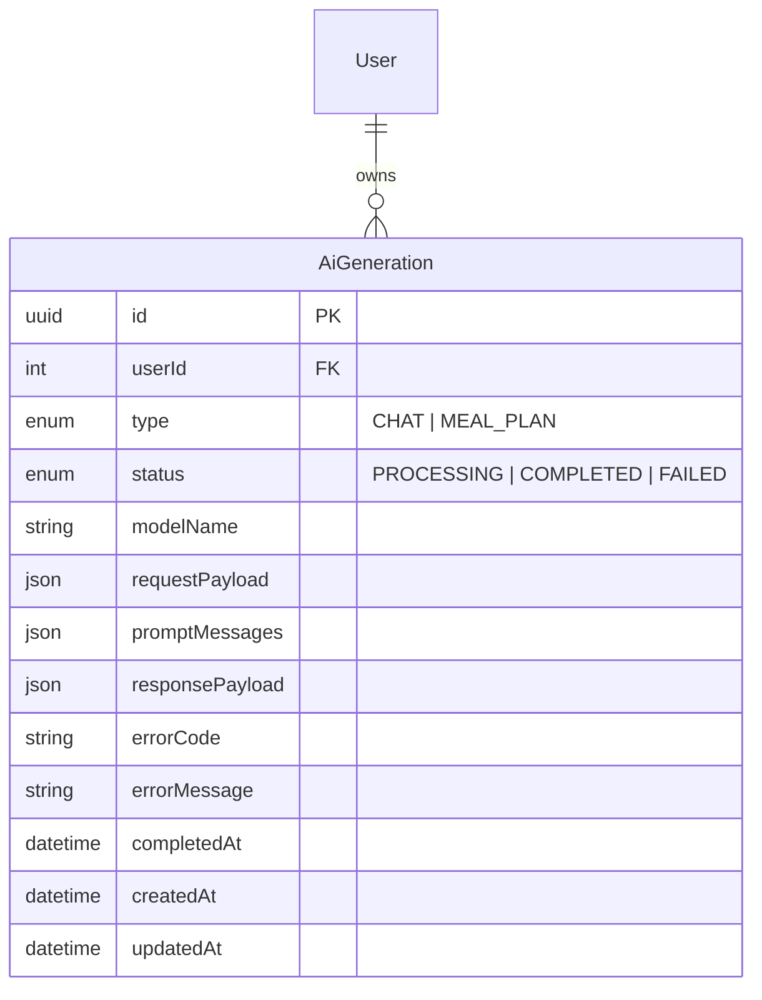
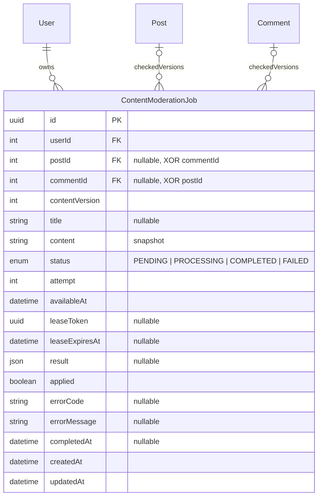

# Sơ đồ Cơ sở Dữ liệu (Entity Relationship Diagram - ERD)

## Lịch sử sinh AI

`AiGeneration` ánh xạ bảng hiện có `ai_generations`; chỉ BE ghi dữ liệu. `promptMessages` là các snapshot `{modelName, attempt, messages}`; `responsePayload` giữ toàn bộ kết quả chat/thực đơn. Không có bản ghi lịch sử cho khách. Chi tiết: [AI_INTEGRATION.md](AI_INTEGRATION.md).

## Job kiểm duyệt văn bản

`ContentModerationJob` ánh xạ `content_moderation_jobs`; chỉ BE/worker ghi dữ liệu. Mỗi job gắn đúng một bài hoặc bình luận (CHECK ở migration), duy nhất theo đối tượng và `contentVersion`. `Post`/`Comment` có `moderationVersion` ánh xạ `moderation_version`. Snapshot và lease chỉ dành cho worker; API tác giả không trả snapshot đầy đủ/lease. Hành vi: [CONTENT_MODERATION.md](CONTENT_MODERATION.md).

## Các bảng nghiệp vụ

Tài liệu thiết kế cấu trúc Cơ sở dữ liệu cho dự án Healthy Food Community & AI Diet Assistant (SWP391), đồng bộ 100% với file cấu hình Prisma (`server/prisma/schema.prisma`).

```mermaid
erDiagram
    %% ==========================================
    %% 1. USER & HEALTH PREFERENCES
    %% ==========================================
    User {
        int user_id PK
        varchar email
        varchar password_hash
        varchar full_name
        smallint role
        varchar status
        datetime deleted_at
        datetime created_at
    }
    DietType {
        smallint diet_type_id PK
        varchar name
        text description
    }
    HealthProfile {
        int profile_id PK
        int user_id FK
        smallint diet_type_id FK
        float height
        float weight
        date dob
        varchar gender
        varchar health_goal
    }
    HealthHistory {
        int history_id PK
        int user_id FK
        date recorded_date
        float weight
        float bmi
    }
    ProfilePreference {
        int user_id PK,FK
        float calorie_goal
        varchar goal
        float protein_goal
        float carbs_goal
        float fat_goal
        float fiber_goal
    }
    UserAllergy {
        int user_id PK,FK
        int ingredient_id PK,FK
    }

    %% ==========================================
    %% 2. CONTENT & COMMUNITY
    %% ==========================================
    Category {
        int category_id PK
        varchar name
    }
    Post {
        int post_id PK
        int author_id FK
        varchar post_type
        varchar status
        datetime deleted_at
        datetime created_at
    }
    Video {
        int post_id PK,FK
        varchar title
        varchar video_url
        varchar thumbnail_url
        int duration
        text transcript
    }
    Blog {
        int post_id PK,FK
        varchar title
        text content
        int attached_video_id FK
    }
    PostCategory {
        int post_id PK,FK
        int category_id PK,FK
    }
    PostAttachment {
        int attachment_id PK
        int post_id FK
        varchar file_url
        varchar file_type
        varchar file_name
        datetime created_at
    }
    Comment {
        int comment_id PK
        int post_id FK
        int user_id FK
        text content
        boolean is_flagged_by_ai
        varchar status
        datetime deleted_at
        datetime created_at
    }
    PostVote {
        int user_id PK,FK
        int post_id PK,FK
        varchar vote_type
    }

    %% ==========================================
    %% 3. INGREDIENTS & RECIPES
    %% ==========================================
    Ingredient {
        int ingredient_id PK
        varchar name
        float calories_per_100g
        float protein
        float fat
        float carbs
    }
    IngredientDetails {
        int ingredient_id PK,FK
        varchar category
        varchar origin
        boolean plant
        text description
        text cooking
        text aliases
        varchar image_url
    }
    IngredientImage {
        int ingredient_id PK,FK
        varchar mime_type
        bytes image_data
        varchar attribution
        varchar source_url
        varchar license
        text license_text
    }
    IngredientAlternative {
        varchar id PK
        varchar chip
        varchar emoji
        varchar original
        varchar role
        jsonb alternatives
        text description
        text keywords
    }
    Recipe {
        int recipe_id PK
        int post_id FK
        int category_id FK
        smallint diet_type_id FK
        varchar recipe_name
        text description
        varchar image_url
        int prep_time
        float total_calories
        text instructions
    }
    RecipeIngredient {
        int recipe_id PK,FK
        int ingredient_id PK,FK
        float quantity
        varchar unit
    }

    %% ==========================================
    %% 4. NUTRITION & MEAL PLANNING
    %% ==========================================
    MealPlan {
        int plan_id PK
        int user_id FK
        varchar title
        date start_date
        date end_date
        float target_calories
    }
    MealPlanDetail {
        int plan_detail_id PK
        int plan_id FK
        int recipe_id FK "nullable khi là món AI gợi ý"
        varchar meal_type
        smallint day_of_week
        varchar custom_food_name "tên món AI gợi ý"
        float calories
        float protein
        float carbs
        float fat
    }
    FoodDiary {
        int diary_id PK
        int user_id FK
        date consumed_date
        varchar meal_type
        int recipe_id FK
        varchar custom_food_name
        float calories
    }
    DiaryNutrients {
        int diary_id PK,FK
        varchar serving
        float protein
        float carbs
        float fat
        float fiber
    }

    %% ==========================================
    %% 5. RESTAURANTS & REVIEWS
    %% ==========================================
    Restaurant {
        int restaurant_id PK
        smallint diet_type_id FK
        varchar name
        varchar address
        varchar phone
        varchar image_url
        float rating
        decimal latitude
        decimal longitude
        varchar source
        varchar place_id UK
        varchar status
        datetime created_at
        datetime updated_at
    }
    RestaurantDetails {
        int restaurant_id PK,FK
        varchar city
        varchar hours
        varchar price_range
        boolean separate_kitchen
    }
    RestaurantReview {
        int review_id PK
        int restaurant_id FK
        int user_id FK
        smallint stars
        text content
        datetime created_at
    }
    RestaurantRecipe {
        int restaurant_id PK,FK
        int recipe_id PK,FK
    }
    RestaurantMenuPrice {
        int restaurant_id PK,FK
        int recipe_id PK,FK
        int price
    }

    %% ==========================================
    %% 6. SYSTEM, REPORTS & AI
    %% ==========================================
    Report {
        int report_id PK
        int reporter_id FK
        int post_id FK
        int comment_id FK
        text reason
        varchar status
        datetime created_at
    }
    Notification {
        int notification_id PK
        int user_id FK
        varchar content
        boolean is_read
        datetime created_at
    }
    AILog {
        int log_id PK
        varchar model_name
        varchar action
        varchar status
        text error_feedback
        datetime created_at
    }
    GuestQuota {
        varchar guest_id PK
        date quota_date PK
        int used_count
        datetime updated_at
    }

    %% ==========================================
    %% RELATIONSHIPS
    %% ==========================================
    User ||--o| HealthProfile : "has"
    User ||--o{ HealthHistory : "records"
    User ||--o| ProfilePreference : "configures"
    User ||--o{ UserAllergy : "allergic_to"
    User ||--o{ Post : "authors"
    User ||--o{ Comment : "writes"
    User ||--o{ PostVote : "votes"
    User ||--o{ MealPlan : "receives"
    User ||--o{ FoodDiary : "logs"
    User ||--o{ Notification : "gets"
    User ||--o{ Report : "submits"
    User ||--o{ RestaurantReview : "writes"

    DietType ||--o{ HealthProfile : "defines"
    DietType ||--o{ Recipe : "categorizes"
    DietType ||--o{ Restaurant : "categorizes"

    Ingredient ||--o{ UserAllergy : "causes"
    Ingredient ||--o{ RecipeIngredient : "used_in"
    Ingredient ||--o| IngredientDetails : "has_details"
    Ingredient ||--o| IngredientImage : "has_image"

    Category ||--o{ PostCategory : "includes"
    Category ||--o{ Recipe : "classifies"

    Post ||--o| Video : "is_a"
    Post ||--o| Blog : "is_a"
    Post ||--o{ PostCategory : "belongs_to"
    Post ||--o{ Comment : "has"
    Post ||--o{ PostVote : "receives"
    Post ||--o{ Recipe : "contains"
    Post ||--o{ Report : "reported_in"

    Video ||--o| Blog : "attached_to"

    Recipe ||--o{ RecipeIngredient : "contains"
    Recipe ||--o{ MealPlanDetail : "included_in"
    Recipe ||--o{ FoodDiary : "logged_as"
    Recipe ||--o{ RestaurantRecipe : "served_at"

    MealPlan ||--o{ MealPlanDetail : "contains"

    FoodDiary ||--o| DiaryNutrients : "measures"

    Restaurant ||--o| RestaurantDetails : "has_details"
    Restaurant ||--o{ RestaurantReview : "receives"
    Restaurant ||--o{ RestaurantRecipe : "serves"

    RestaurantRecipe ||--o| RestaurantMenuPrice : "priced_at"

    Comment ||--o{ Report : "reported_in"
```

